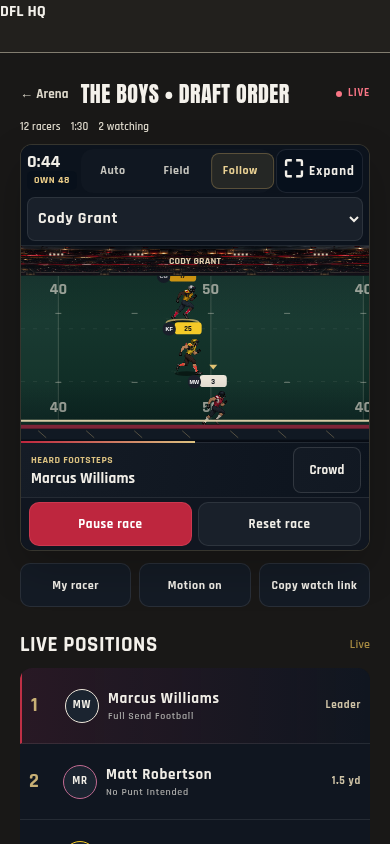
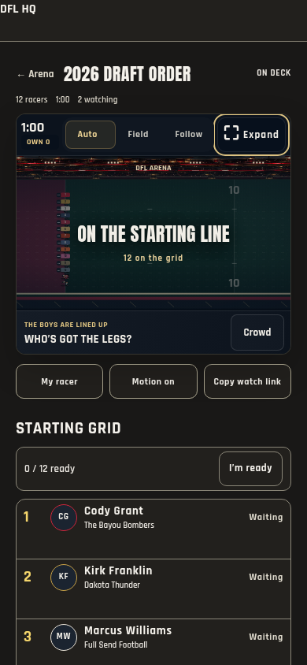
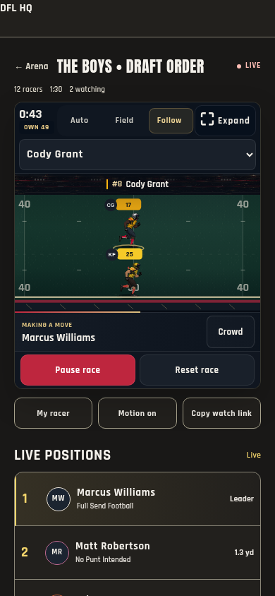
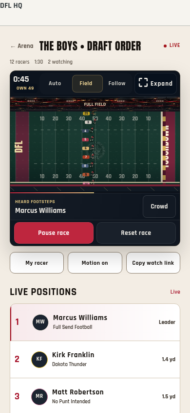
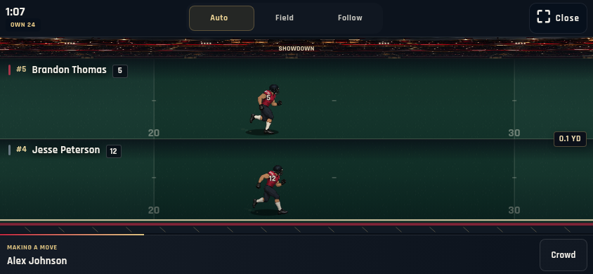
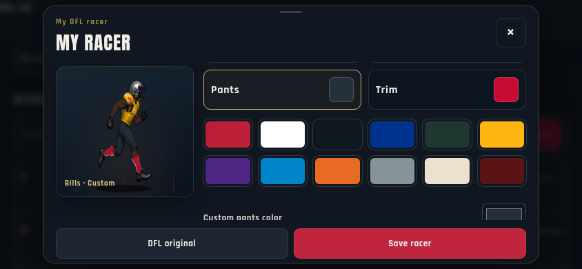
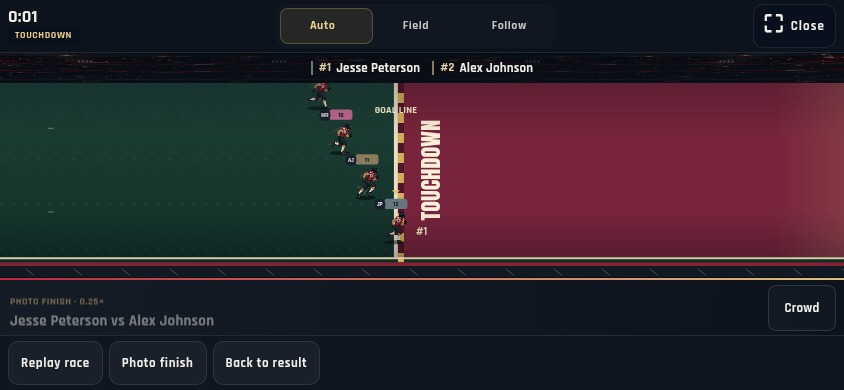

# Arena visual and interaction review — 1.445.0

Reviewed 2026-10-19. Goal: a clean, readable mobile race with coherent camera
framing and reachable controls throughout the viewing flow.

The review began with fresh screenshots of the current 1.444.0 controller and
renderer, served against an isolated shared-clock fixture. Follow on a 390px
phone clipped the edge-lane racer’s identity/helmet. The idle page repeated the
entire roster before the starting grid. The gear editor’s translucent sticky
header allowed scrolled controls to bleed through. Regular camera labels were
small Canvas text. Those are corrected in this release.

## 1. Starting grid and live standings — healthy after correction

Readiness now belongs to each racer’s existing starting-grid row, with one
compact ready-count/action strip. The duplicate roster is removed. Standings,
secondary actions, ranks and supporting team names use the selected app theme;
the stadium and NFL/member identity colors retain their intended roles.
Outer race-state and connection labels use theme-aware status ink. The old
Light-mode gold/live colors had insufficient text contrast; the new live status
is checked at 4.5:1 or higher in each mobile theme. Supporting team text is larger and loses excessive letter spacing. Keyboard
focus is restored to the same control when real position changes reorder rows.
Ready descriptions are exposed to assistive technology only while on deck.

## 2. Race, close-ups and camera selection — healthy after correction

Follow reserves room for the helmet/badge and feet and uses a closer shot.
Larger screens also allow larger close-up artwork instead of keeping the old
small-sprite cap. Paused camera changes now finish on the selected racer instead of freezing an
incomplete glide; the finite transition settles exactly and then remains still.
Pause status stays in the commentary strip so the paused field remains clear for
camera inspection.
Current ranks and actual racer names appear at native text size in the existing
stadium band. Field, launch and reduced-motion overviews keep their own labels;
showdown retains its dedicated names without a second copy. A small cached turf
grain adds detail without another animation loop, asset download or per-frame
noise generation. The seeded draw, clock, paths and official order are unchanged.

## 3. Expanded viewing and commissioner tools — healthy in browser checks

Portrait retains a 16:9 field with full-size controls. Expanded landscape,
native fullscreen and the CSS fallback keep camera selection and close controls
inside the watch view. Rotation, explicit close, late fullscreen requests,
commissioner edit, start/pause/resume/reset, uniform saves and readiness remain
covered by the production-controller fixture. Sticky gear headers/footers are
opaque; focus outlines remain visible while editing and on standings rows.

## 4. Finish, replay and past races — healthy in browser checks

The fixture verifies the complete official finish order against the shared
sealed draw. Full replay and quarter-speed goal-line replay remain local viewing
actions. Cancelled/stale removal keeps the original result; authorized removal
updates the lobby and open viewers. Readiness, reactions, cameras and replay
never determine or write finishing places.

## Validation and limits

Run `DFL_REVIEW_CHROMIUM=/usr/bin/chromium python tools/capture-stadium-arena.py`.
The review covers 320/390/768px Light and Dark, expanded landscape, two/12/32-racer
fields, first/last-lane Follow and a 1440px desktop. Tests inspect layout bounds,
selected identities, native control targets, horizontal overflow, motion-off,
paused pixel stability, live keyboard focus and shared-clock management. Canvas
instrumentation checks the actual selected runner body bounds in edge-lane
shots, including a paused first-to-last racer switch. Actual
screenshots were inspected before and after the changes. Current artifacts and
JSON checks are retained in `/tmp/dfl-1445-arena-accessibility/`; CI uploads the stadium
review as an artifact. The final browser run passes 258 checks with no page errors. Release validation
includes `pnpm check` (1,936 tests across 234 files) and the hosted
Arena database/control and Home regression checks.

This is a scoped UX/design/accessibility review, not a WCAG conformance claim.
Headless Chromium does not verify physical iOS/Android browser fullscreen,
GPU frame rates, haptics or screen-reader speech. No real races were changed or
notifications sent by this review. The browser fixture verifies client behavior;
the isolated PostgreSQL CI suite separately checks database permissions and
maintenance behavior.
