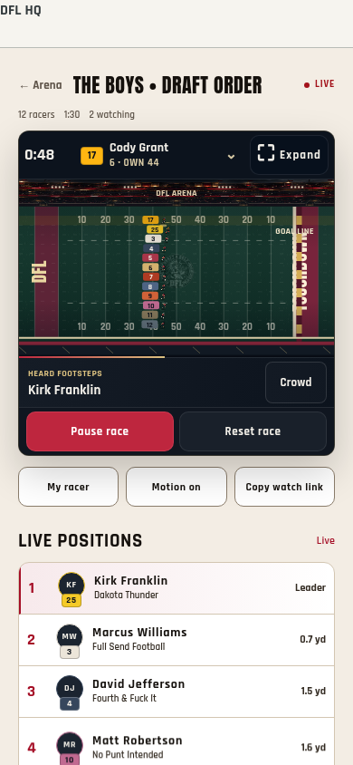
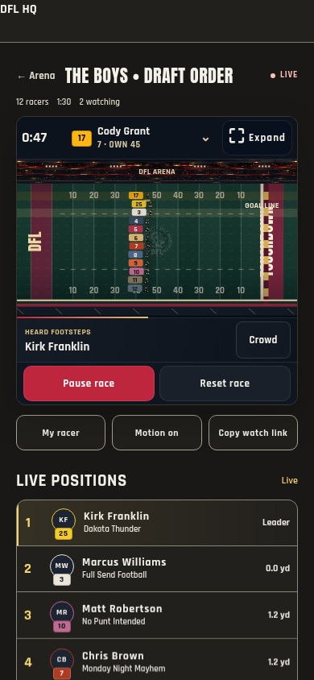
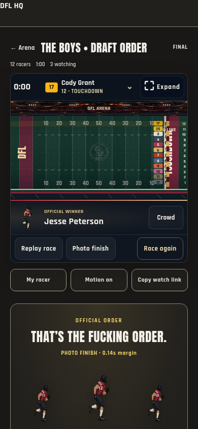
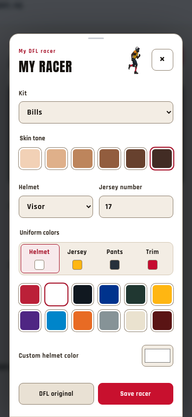
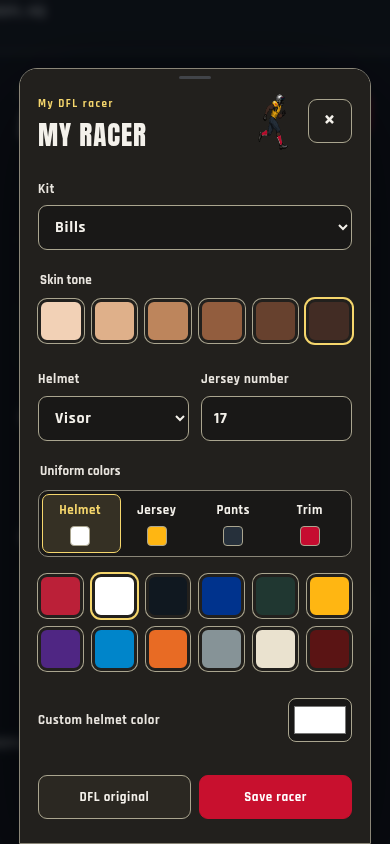

# Arena racer identity and presentation — 1.447.0

The Arena keeps one fixed full-field view through live races, finish and replay.
This update connects each racer's saved jersey number to their name, improves
the phone standings, and brings the customized runners into the result.

## Changes

- Replace the redundant Full field label with the selected racer's number,
  name, place and field position. A native select changes the highlighted
  racer, including in fullscreen; selecting never changes the camera or draw.
- Add matching jersey badges beside profile photos in the standings. Natural
  row heights start at 56px and expand for full team names. Actual order changes
  animate with transforms, preserve keyboard focus and respect reduced motion.
- Keep standings sorted after a live kit refresh, even when rank order has not
  changed. Cancel row motion when the motion setting is disabled.
- Add small turf kicks during faster strides and a brief lane accent when the
  leader changes. These use the existing race frame and animation loop. They
  neither generate positions nor alter the sealed finishing order.
- Move finish-place labels into the margin beyond the painted endzone. Suppress
  illegible labels in very dense fields; the full named standings remain.
- Show the official winner's saved runner in the stage footer and customized
  runners on the podium. Show the footer reveal only after complete official
  results arrive, hide it during replay, and reuse the existing shared art atlas.
- Let the large uniform preview scroll away on phones and show a small animated
  preview in the sticky header. Keep skin, helmet, number and color controls
  clear of the large preview. Add a sliding part selector and theme-token gear
  controls in both Light and Dark.
- Simplify commissioner setup with a single phone picker column, optional custom
  duration and a separate scrolling field area above the persistent Save button.

## Verification

`pnpm check` passes: 1,934 tests across 234 files, release consistency, theme
colors, TypeScript, name checks and the production build. The final source
adjustment to invalidate rebuilt standings order is also covered by the browser
regression below; name checking and the production build were rerun afterward.
The bundle contains 78 application modules, 3 startup modules and 4 Home modules;
no dependencies or extra race animation loops were added.

`tools/capture-stadium-arena.py` passes **217 checks with zero page errors** using
the production controller and renderer with isolated race data. Coverage includes:

- All actual runner atlas bodies remain inside the field for 2, 12 and 32 racers,
  at 320/390/768px mobile/tablet and 1440px desktop sizes, across race progress,
  highlighting, expanded viewing and replay.
- Matching saved kit numbers and names in the toolbar and standings; switching
  highlights produces no race command and preserves the wide frame.
- Full team names fit inside compact rows in Light and Dark; a live kit refresh
  does not revert the standings to starting order.
- Winner footer art has actual rendered pixels, names the sealed winner and
  hides during replay. Podium and field jersey identities match.
- Gear previews, theme surfaces, independent member kit saving, cancel, focus
  restoration, immediate reduced-motion painting and scrollable controls.
- Commissioner editing, custom/preset duration, start/pause/resume/reset, late
  joins, readiness, reactions, sound opt-in, unauthorized/stale commands, removal,
  orientation, fullscreen fallback and cleanup remain covered.

The run uses fake shared-clock snapshots and commands; it never connects to the
league database or changes real races. Physical iOS/Android fullscreen, hardware
frame pacing, live production synchronization and a full screen-reader journey
remain unverified.

## Reviewed mobile captures

