# Broadcast finish — 1.522.0

The broadcast keeps its wide 232px mobile frame, existing house illustrations,
independent daily opener and loose league copy. The refinement removes the hard
image-column backgrounds and gives the remaining slide types consistent spacing,
art insets, story footers and numerical emphasis. Sources, exact scores, grades,
transactions, routes and timing controllers retain their meanings.

## Review steps and findings

1. **Champion and Chip Eater — corrected and verified.** The champion had a
   flat tinted region starting at 57% of the card, visible as a rectangular edge.
   Both awards now use an inset radial glow with fully transparent outer stops.
   The art has right/bottom breathing room, with the complete upper silhouette
   contained. The champion's cropped lower edge blends softly into the surface;
   the Chip Eater keeps its complete toilet illustration. Headings have a little
   more line spacing; the icon/kicker fits the narrow phone layout.

   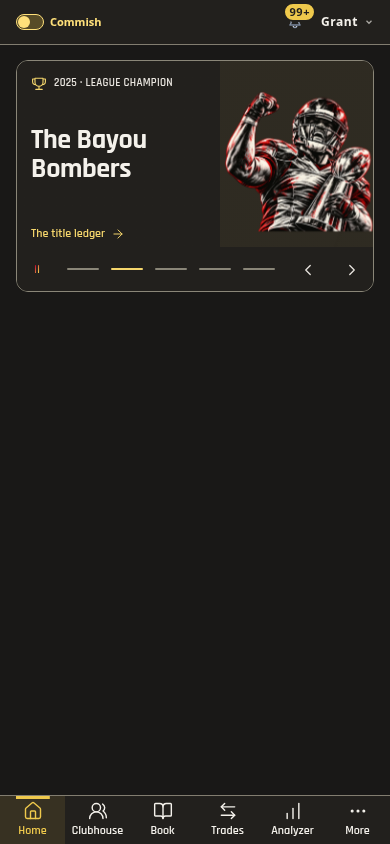
   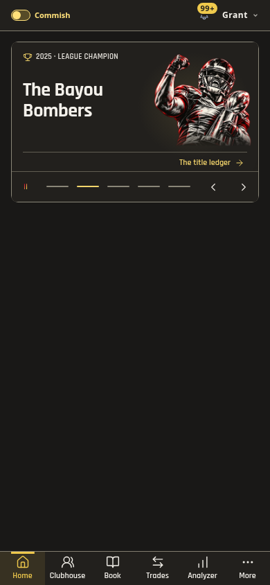
   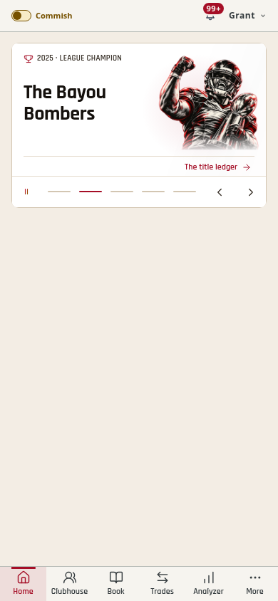
   

2. **Record and metric cards — corrected and verified.** An archive value such
   as 0.04000001 already displayed as 0.04, but its raw precision was used to size
   the typography. Sizing now follows the displayed string. The same 0.04 remains
   factual and readable at 390px, with the metric's detached vertical separator
   removed. The archive gets a Record book category and View record action when
   no custom action is supplied. Playoff actions identify the playoff picture.

   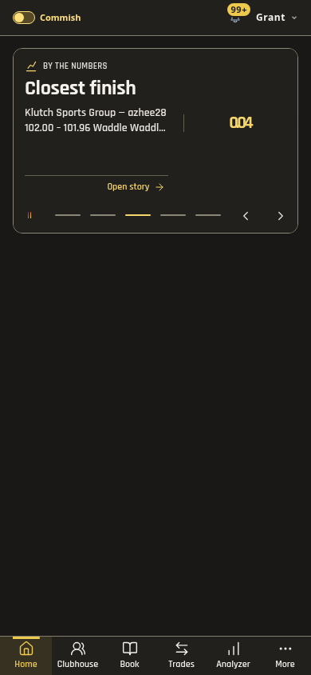
   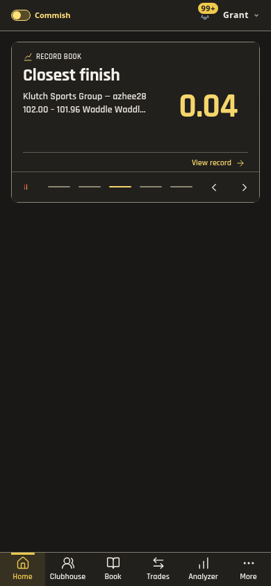

3. **Auto Scout and illustrated stories — corrected and verified.** Scout had
   a hard split at 59%, with its portrait pressed toward the card bottom. It now
   uses the same soft, inset lighting and reserves room for the story footer.
   The portrait's lower edge fades into the card; its head stays unobstructed.

   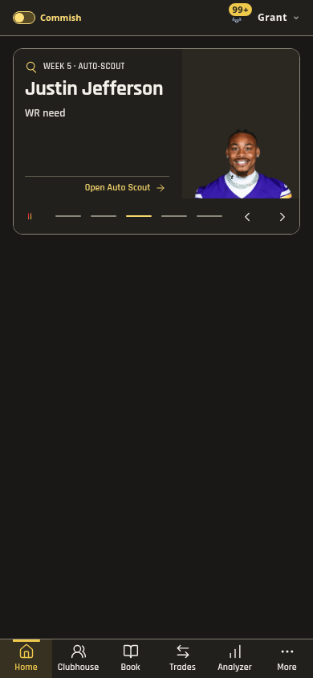
   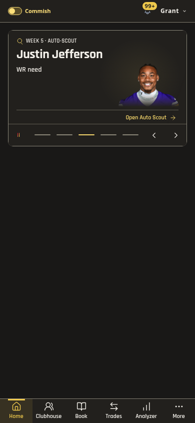

4. **Trades, results and shared frame — verified.** The compact trade rows and
   two-score results already worked well. Consistent 16px inner spacing, an 8px
   corner radius and full-width story footers now connect them with the awards
   and illustrated cards. The controls have a quiet divider and keep their 44px
   targets. No explanatory filler or additional information strip was added.

   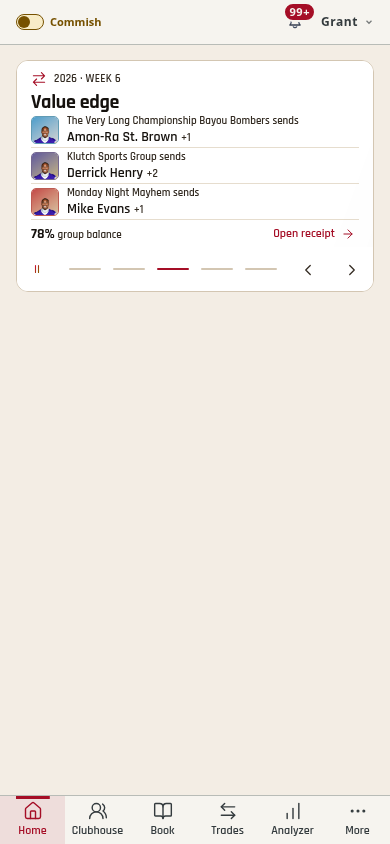
   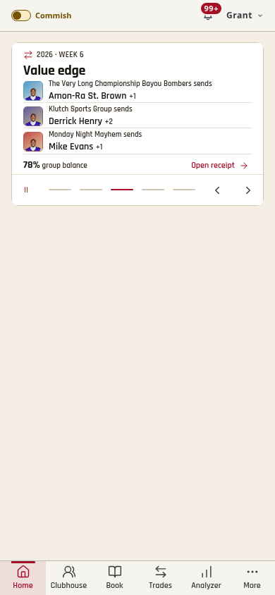
   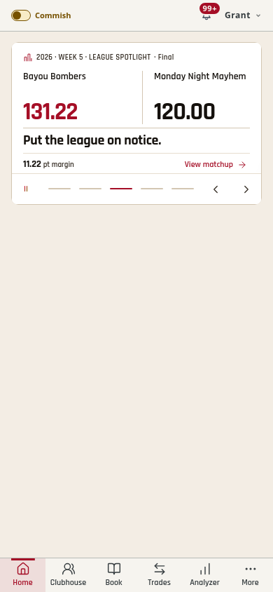

5. **Controls, motion, zoom and live app — verified within the captured scope.**
   Fifteen story cases pass at 320/390/768px in Light/Dark with stable frame height,
   contained art, separate text/images and readable contrast. Enlarged text wraps
   names and categories. Forward/reverse swipes do not activate a story link;
   first-read dwell, below-fold pauses, manual selection, one-pass rotation,
   replay and Reduced Motion retain their behavior. Real Home slides also fit in
   both themes with a 232px frame and intact score-dock return.

   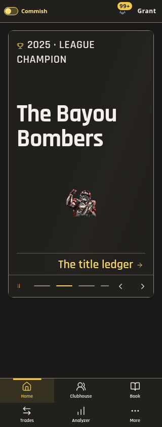
   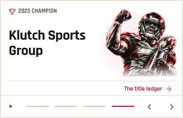
   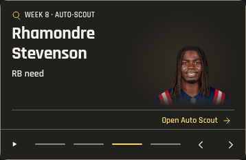

## Verification and limits

- `pnpm check`: 2,415 tests / 293 files; release/themes/types/names and production
  build pass. The build remains 90 application modules, three startup/four Home
  and 57 shared CSS sheets in one request. No new assets, dependency or timer.
- Current-run screenshots cover 90 normal and 56 enlarged layouts. Thirty 390px
  slide samples check UI text contrast and all visible button targets. Eight
  isolated glow rasters show a maximum neighboring RGB-channel step of 1–2 and
  **zero edge difference** from the surrounding background; these are numerical
  checks of captured pixels, rather than only CSS declarations. A focused CI job
  repeats the gallery, gradient and first-read checks.
- Actual built app: eight real slide/theme cases and two score-dock checks,
  read-only with production writes blocked. No browser errors.
- Capture used the repository's production-component Playwright workflows and
  read-only built app. The Product Design audit/framework were consulted; their
  additional user-context/browser helper resources were not available in this
  session's skill catalog. No saved design-context setup was changed.
- This is a broadcast review, not a full accessibility certification. Screen
  reader speech, physical phone frame pacing and older Safari rendering remain
  unmeasured. Decorative glow raster checks do not establish all image contrast.

The new glows are static gradients and the artwork uses static masks. Existing
whole-slide transitions and motion preferences remain; no animated blur was added.
