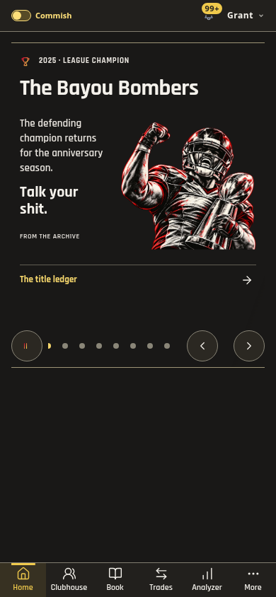
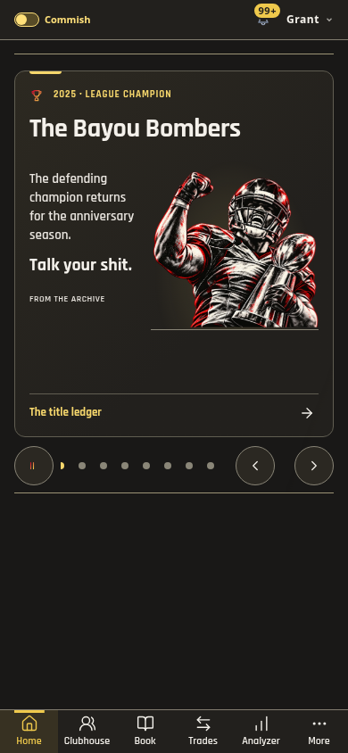
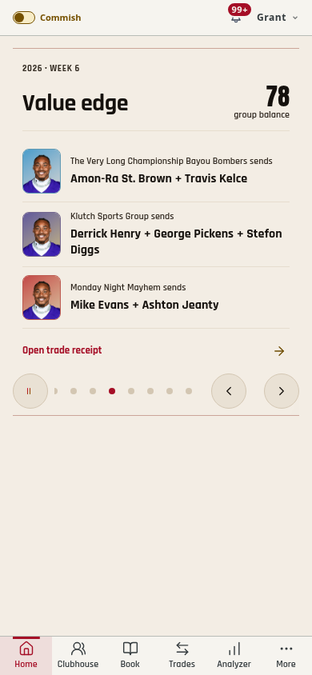
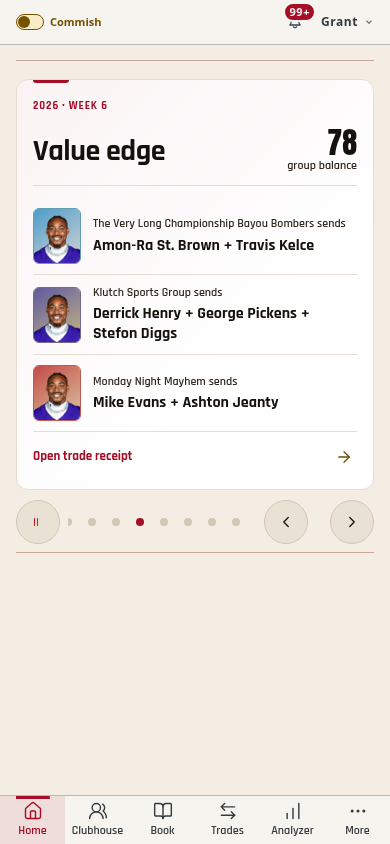
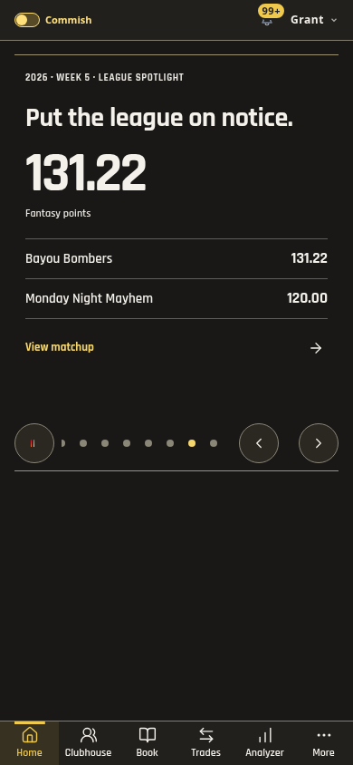
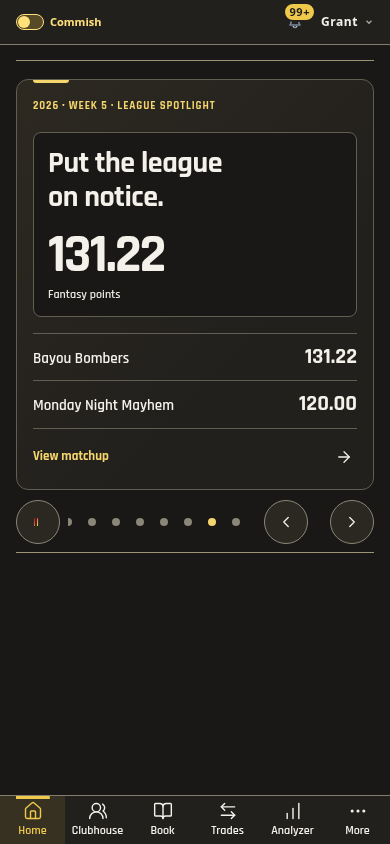

# Broadcast polish and automatic trade alerts — 1.497.0

The current-run screenshot review used production renderers and isolated league
fixtures before changing the design. The daily opener and existing art stay;
secondary stories now share a card boundary, accent marker, clearer hierarchy,
framed figures and a consistent bottom action. Award pictures remain the house
illustrations, never member avatars. Existing gestures and timing stay on the
shared controller.

## Screenshot review

1. Awards — readable before, visually disconnected. The reviewed result gives
   the complete figure a baseline, leaves the full team name above it and aligns
   the footer with the content. Health: improved; long-name bounds pass.
2. Trade — accurate package rows before, little visual hierarchy. The result
   groups grade/balance, separates compact packages and keeps all three teams
   visible. Health: improved; full names and receipt links retained.
3. Spotlight — large text before, weak grouping. The result separates the main
   metric from the exact matchup scores and anchors its action. Health: improved;
   figure/headline separation passes.

| Step | Before | After |
| --- | --- | --- |
| 1. Champion, Dark |  |  |
| 2. Three-team trade, Light |  |  |
| 3. Spotlight, Dark |  |  |

## Trade detection

Production already polled full Sleeper data every five minutes but its adaptive
worker gated roster-mode reconciliation to once an hour between games. Alerts
were created inside that reconciliation, so an off-day trade could wait for it.

`trade-watch` now checks transactions every two minutes independently. It runs
with the app closed, respects the existing automatic-sync switch, reads both the
current and previous week, deduplicates transaction IDs and preserves the
transaction's original week in receipts. It fetches users/rosters and invokes the
existing analyzer/receipt/notification pipeline only for missing receipts or
pending phone alerts. Source keys and receipt unique keys retain existing
idempotency; historical receipts do not become surprise breaking alerts. No
scoreboards, sportsbook setup or full weekly reports run inside this poll.

The worker uses the existing Vault cron token and server-side Supabase key.
Unauthenticated calls return 401. Dry run performs no claims, receipts or pushes.
A 90-second atomic claim prevents overlapping polls. Heartbeat/error columns
record successful checks and upstream failures for the next retry. No public
write policy or new table is added; advisors report no trade-watch findings.
Existing project advisory findings remain outside this change.

## Verification

- Full checks: 2,270 tests in 274 files; release/theme/type/name/build checks pass.
- 23 focused worker/capture tests cover independent detection, pending versus
  completed trades, delivery retries, previous-week rollover, read-only dry run,
  ownership validation, duplicate rows, disabled sync and overlapping runs.
- 52 slide layouts at 320/390/768 Light/Dark include action/kicker bounds,
  long names, full art, three-team packages and stable card height. Both-theme
  visibility, dwell, resume, reduced-motion and cleanup checks pass.
- Real-data production-asset browser check verifies the actual Home deck and no
  horizontal overflow. Public asset verification follows the merge.
- Deployed worker dry run returned four completed trades and no pending work.
  Three consecutive scheduled runs returned HTTP 200, no errors, no duplicate
  receipts and no notifications. No league/test transactions or test pushes were
  created. A future real completed trade is needed to observe physical delivery;
  delivery/retry behavior is covered with isolated fixtures.

Detection is polling, typically within two minutes plus processing and provider
latency. In-app coverage also has its existing one-minute refresh. Physical iOS,
notification-provider delays and screen-reader speech were not manually tested.

## Operations

Deployed Edge Function `trade-watch` version 1 with custom token verification;
SQL migration `automatic_trade_watch` enables `dfl-trade-watch` on `*/2 * * * *`.
The existing full-sync jobs remain. Disable that job to roll back only trade
polling. The function can be rebuilt without installing a client dependency:

```sh
npx --yes esbuild@0.28.2 supabase/functions/trade-watch/index.ts --bundle --format=esm --platform=neutral '--external:npm:*' --outfile=/tmp/dfl-trade-watch/index.js
```

The deployed bundle includes the shared receipt model and analyzer modules;
`npm:@supabase/supabase-js@2.57.4` remains explicitly pinned.
