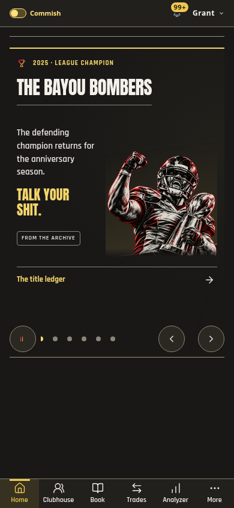
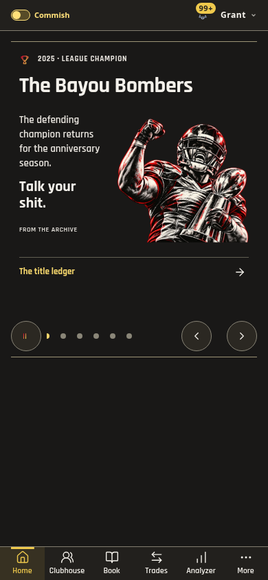
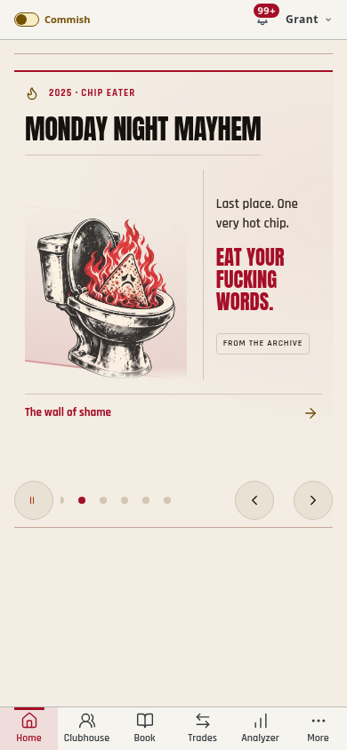
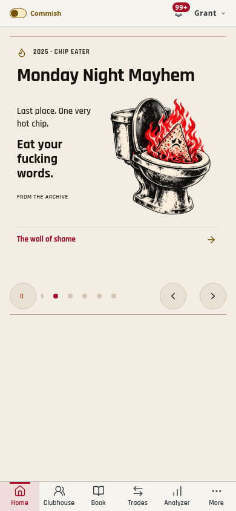

# Broadcast presentation — 1.462.0

The Home broadcast keeps its illustrated opening card and uses the app's clean, square type for subsequent stories. Secondary headings retain their natural case; the oversized condensed callouts, repeated accent rules, radial washes and skewed award backdrop are removed. Subordinate copy stays at 15px. Archive, news and calendar illustrations occupy a consistent 152px window; trade participants use compact 48×56px portrait rows so two- and three-team deals fit together.

Champions now use the league's trophy-player illustration, including past champions. The Chip Eater uses its dedicated illustration. Automatic generators no longer look up a member's broadcast/profile photo. Home also ignores a member image supplied by an older cached award item or override. Names, seasons, owner labels, ordering and History destinations are preserved. Explicit custom artwork remains available in the standalone non-editorial renderer.

Award illustrations stay fully opaque and contained, with no crop mask or decorative shadow. A shared heading row reserves the full width for the team name; copy and art occupy separate columns. Long names wrap without ellipsis. The same reserved deck height remains in place during rotation, so the page below does not jump. Existing swipe, first-read, autoplay, scroll-depth and motion preferences remain on the shared stage controller; entrances are shorter and use transform/opacity.

## Current-run visual review

1. Champion: the former faded illustration and competing headline/callout now have one clear hierarchy. The dedicated award art replaces member portraits.
2. Chip Eater: the same layout, with the league's flaming-chip artwork and its existing roast. The image and text have separate columns.
3. Trade: quieter separators, compact portraits and readable package names retain all three participants on one card.
4. Injury and history: consistent heading weight, supporting type and image framing align these stories with the rest of Home.

Current-run before/after captures are in `broadcast-presentation/before/` and `broadcast-presentation/after/`. The long-name cases are cropped card screenshots; the other captures include the surrounding mobile shell. All use production rendering with deterministic league fixtures, not a live member account.

| Screen | Before | After |
| --- | --- | --- |
| Champion, Dark / 390 |  |  |
| Chip Eater, Light / 390 |  |  |

## Validation

- `pnpm check`: release agreement, themes, TypeScript, name resolution, 2,019 tests across 246 files, and generated builds. The app remains 79 modules, with 3 startup and 4 Home modules; the 1.461.0 bundle is unchanged.
- 40 Light/Dark layout cases at 320/390/768px, including long champion names at 320/390px. Checks cover text/art separation, complete names, controls, no horizontal overflow, correct house art and stable rotation height. A fake member-photo URL explicitly tests the cached-avatar regression.
- 24 award compositions at 320/390/430/832px: loaded images, contained artwork, full opacity, distinct copy columns, headline/footer separation, contrast and mobile edges.
- Light/Dark observer/timer scenarios: below-fold hold, full first dwell, resume, preserved manual choice, short landscape viewport, reduced-motion autoplay and teardown.
- Unit regressions cover current/past champion and Chip Eater generators with member photos present, and the Home renderer rejecting member art while preserving the correct winner and destination.

No palette entries or arbitrary UI colors were added. Actual Light/Dark phone frames were inspected, including the long-name edge case. Fixture checks cover visible contrast and geometry; physical-device frame pacing, screen-reader speech and native browser behavior remain unverified.
