# Broadcast award and trade presentations — 1.523.0

The Home broadcast retains its short, wide mobile frame and existing house
illustrations. Champion, Chip Eater and Trade now have distinct compositions,
clearer reading order and brief entrances. The independent daily opener stays
intact. Current activity still leads, with one daily archive slot; the existing
edition rules expire automatic trades and news after three days.

1. **Champion — refined and verified.** The title holder's name leads the
   poster, followed by one line: “Everybody else played for second.” Long names
   use the space without that optional line. The complete upper silhouette stays
   contained. The lower fade now follows the image's actual bounds instead of a
   letterboxed container. No member avatar or shield is used.

   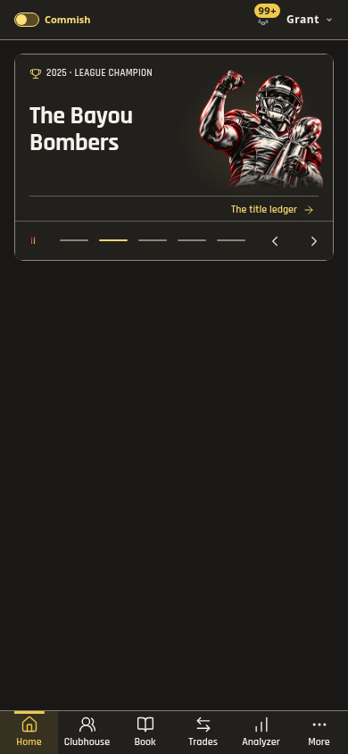
   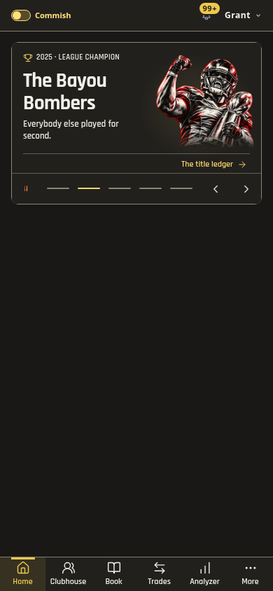
   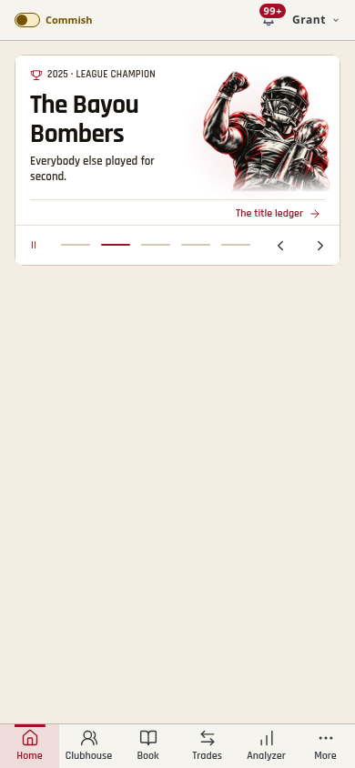

2. **Chip Eater — distinct and verified.** The complete flaming toilet sits on
   the left, the name on the right, with “Last place. Still talking shit.” The
   existing inset glow follows the artwork to the left and fades fully before
   the card edges. The history action aligns to this composition.

   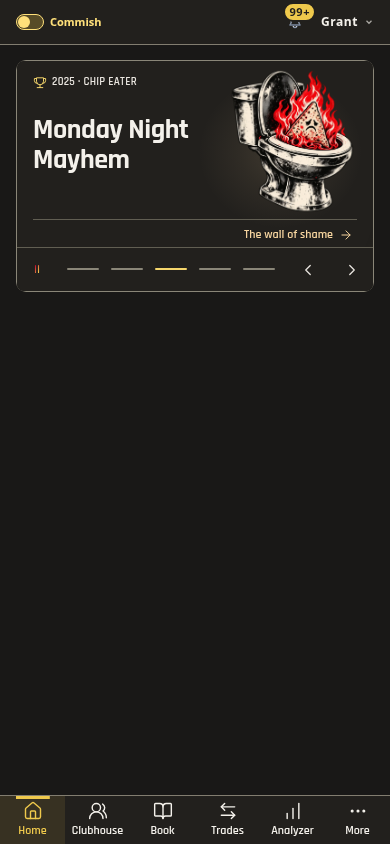
   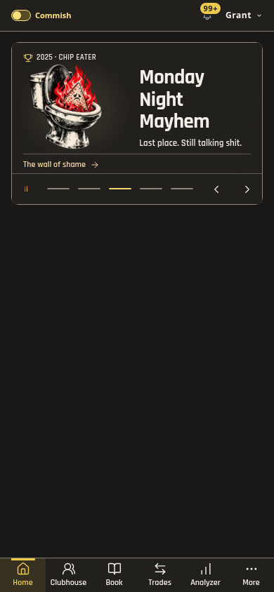
   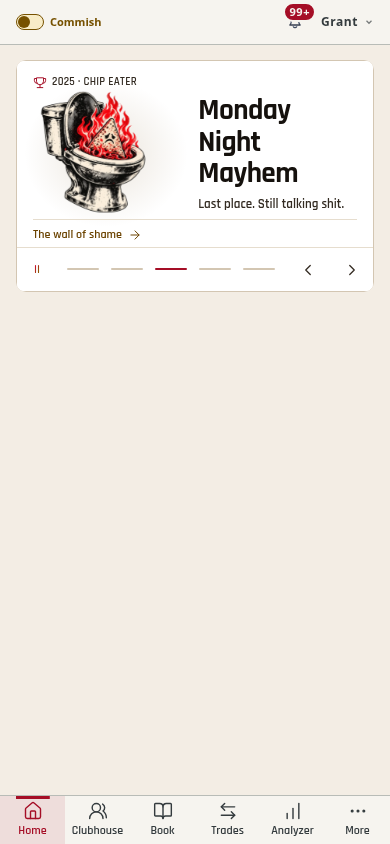

3. **Trade — clearer and verified.** Two-party trades use side-by-side packages,
   larger lead portraits and a second visible player name where available.
   Three-party trades retain compact rows. A sourced balance percentage has a
   proportional bar; missing or invalid percentages never generate one. The
   grade and receipt link retain their original meaning and destination.

   Incoming packages are passed from the receipt model and matched by roster ID,
   including reordered three-way trades. Only verified routes say “gets”; absent
   or ambiguous routes retain “sends.” The direction remains visible beside a
   truncated long team name. The link's accessible name preserves all sending
   players, verified receiving players and the balance, including packages beyond
   the three visible teams.

   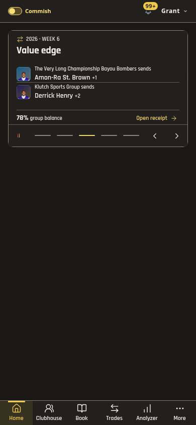
   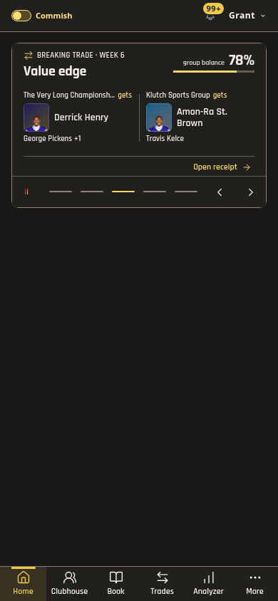
   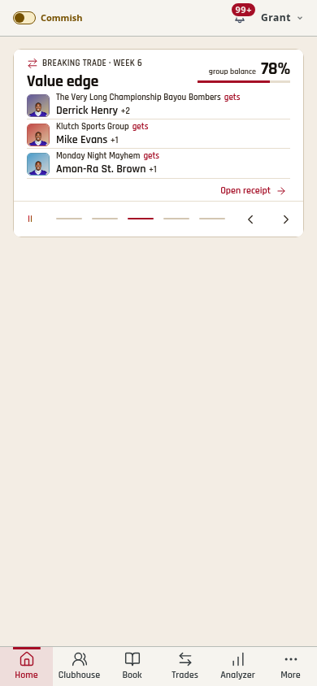

4. **Motion and accessibility — verified within the browser scope.** Artwork
   settles over 360ms; copy follows after 65ms and settles over 260ms. The balance
   bar resolves with a transform rather than a layout animation. An older,
   higher-specificity delayed reveal is explicitly disabled so it cannot fight
   this sequence. Direct swipes settle the whole card without replaying child
   entrances. Entrances pause offscreen and resume without restarting on return.

   Visible entrance effects are independent of the first-read autoplay gate, so
   an award low in the viewport does not stay faded. Motion off and Reduced
   Motion disable the effects. Phone widths, long names, enlarged text, text
   contrast, 44px controls, stable rotation height, reverse swipes, one-pass
   playback, manual replay and cleanup are checked.

   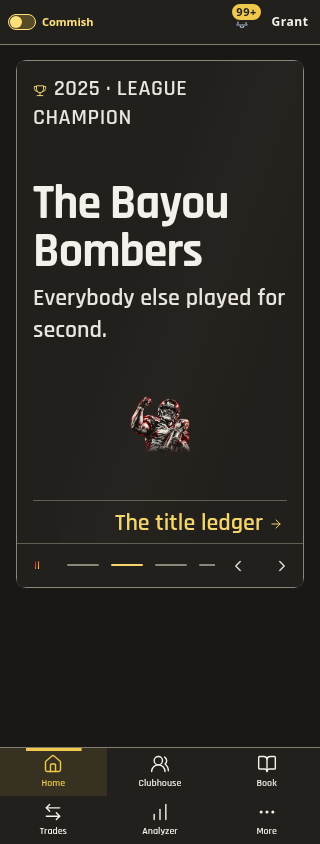

5. **Real Home — checked read-only.** Both themes use the production bundle,
   actual Home stories and league data. The visible champion is house artwork,
   with clear copy and a 232px frame. The existing score dock retains its exact
   source names/scores and return target. Supabase mutations are blocked in the
   browser test except explicitly allowlisted read RPCs.

   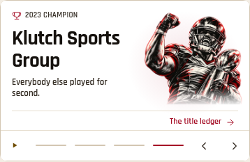
   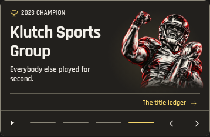

Validation: `pnpm check` passes 2,419 tests in 293 files, including release,
theme, type, identifier and production bundle checks. Browser evidence includes
90 normal layouts, 56 enlarged layouts, 30 contrast/touch samples, eight isolated
glow probes, and the actual Home checks. See [coverage.json](broadcast-signatures-1523/coverage.json),
[finish-checks.json](broadcast-signatures-1523/finish-checks.json) and
[real-checks.json](broadcast-signatures-1523/real-checks.json).

Limits: trade screenshots use isolated fixtures, including reordered receiving
packages; the current real Home edition did not expose a recent trade. No
production transaction was created to force one. Browser tests do not establish
physical iOS frame pacing, battery savings or screen-reader speech. No new image,
font, dependency, polling interval or perpetual animation was introduced.
