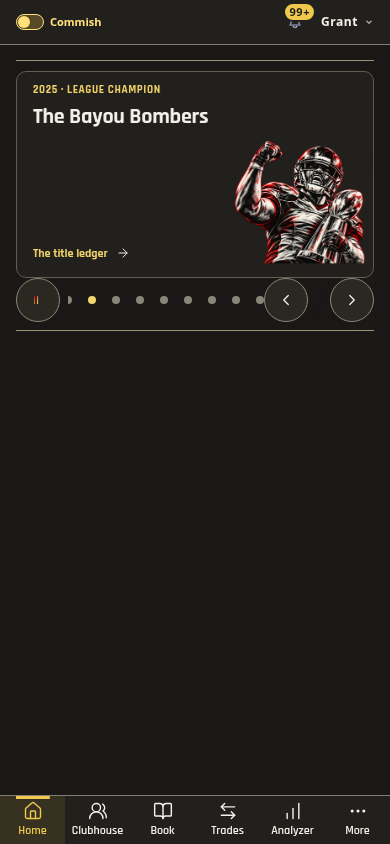
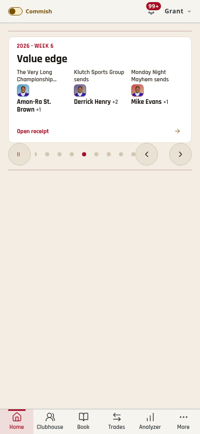
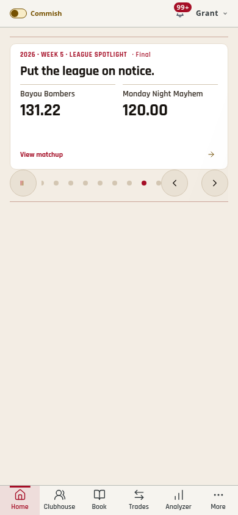
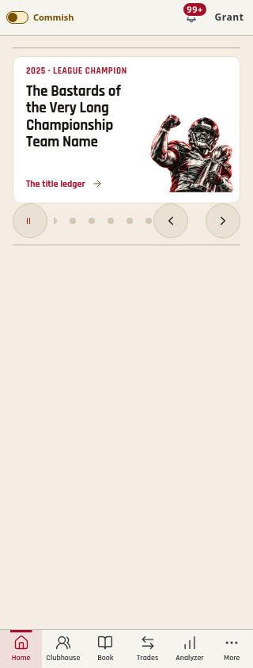

# Widescreen Home broadcast — 1.498.0

The prior carousel measured the tallest complete story and reserved that height
for every slide. It also kept the champion, Chip Eater and anniversary in each
edition. The result was a tall, repetitive loop.

Home now uses purpose-built wide previews, with width-based stable sizing rather
than measuring complete articles. At 390px the stage is 269px, compared with
522px in the previous full-card component review. At 320 it is 248px; the
content windows stay landscape. Awards keep the complete house illustration and
full name; scores sit side by side without a duplicated winner figure; trades
show compact lead-player packages and open the complete existing receipt. Numeric
figures adjust to their length. Confirmed live/final game states remain visible.
The daily opener keeps its existing image. Full-card renderers remain supported
for their separate presentation and regression cases.

## Short, changing editions

- Keep the independent Chicago-dated opener, up to four distinct current stories,
  and one daily archive feature. Explicit commissioner pins/features are honored.
- Champion, Chip Eater, anniversary, records and league history share that one
  archive slot. Brand-only filler drops out. Quiet days have fewer cards.
- Deduplicate repeated syncs and repeated automatic sources. Automatic news ages
  out after three days; explicit editorial pins remain.
- Rotate the league spotlight among verified completed matchups each day, with
  exact names/scores and its original season/week. Exclude the member's own
  matchup already covered above. Existing proven streak/record stories take
  their turn; no new points, outcomes or activity are invented.
- Autoplay stops after one pass and remembers completion in session storage.
  Returning to the same edition stays still; new visible story data can play
  again. Fetch timestamps alone do not mark an edition new. Explicit replay
  starts from the beginning, and manual arrows/swipes keep working.
- Preserve the active card through reordered/updated data, defer updates during
  gestures, and avoid resetting to the opener when a removed story is replaced.

## Current-run screenshots

| View | Wide preview |
| --- | --- |
| Champion, Dark / 390 |  |
| Three-team trade, Light / 390 |  |
| League result, Light / 390 |  |
| Long award name, Light / 320 |  |

The previous release's full-card captures are in
[broadcast-polish-and-trade-watch-1497.md](broadcast-polish-and-trade-watch-1497.md).
All published documentation screenshots use isolated league fixtures.

## Validation

Full release/theme/type/name/build checks and 2,282 tests across 276 files pass.
The wide browser matrix passes 90 Light/Dark composition checks at 320/390/768,
including text/control bounds, correct art, contrast, fixed rotation height,
readable type and no overflow. Native repeated forward/back swipes do not follow
story links. One-pass stopping, manual replay, session return, new story updates,
larger-text scaling and reduced motion pass. Both-theme first-dwell, offscreen,
manual choice, short viewport and teardown checks pass.

The real-data browser check using production assets shows three Home cards in
both themes at 269px, versus six stories before curation. Scores, links and
complete images stay within the card. No league records or notifications were
written by verification. Public asset comparison and the public browser smoke
are repeated after deployment. Physical-device frame pacing, OS-specific text
settings and assistive-technology behavior were not manually exercised.
