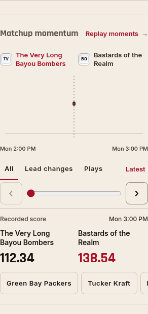
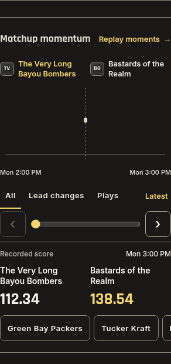

# Clubhouse matchup fit and Leaders effects — 1.526.0

The populated Bayou Bombers / Bastards matchup reproduced the clipping at
320px and 390px while other matchups fit. Its recorded momentum content set
the outer grid's automatic minimum width to about 423px. The grid now uses a
zero-minimum flexible track, and the matchup section can shrink to its available
width. Native momentum/history rails keep their own horizontal scrolling.

Leaders previously reconciled its entire host on every repaint, removing the
canvas that renders fire and ice. Its rows now update inside a dedicated child;
the existing effects surface remains a sibling through filtering, bench changes,
live score updates and tab returns. Scoring thresholds, motion settings and
Reduced Motion behavior retain their existing rules.

The browser regression uses the actual momentum renderer with populated score
history, long team names and several player moments. Restoring the previous grid
rules reproduces its failure at 320px. The layout matrix additionally checks the
matchup wrappers themselves, since document-level overflow checks miss content
clipped by the app shell.

Verification: `pnpm check` passes 2,419 tests across 293 files, plus release,
theme, type, identifier and production-build checks. Mobile screenshots were
inspected in both themes. Read-only checks cover every real matchup at
320/375/390/430px in Light and Dark, plus effects-surface preservation: 50 cases,
no browser errors. Actual Leaders fire was also visually confirmed with WebGL
running. The broader Clubhouse suite checks filters, refreshes, bench changes,
tab returns, native gestures, media, navigation and teardown; the layout matrix
includes Compact/Comfortable modes and 100/125/200% text.

Evidence: [layout checks](clubhouse-fit-effects-1526/layout-checks.json),
[real matchup checks](clubhouse-fit-effects-1526/real-checks.json), and
[Clubhouse checks](clubhouse-fit-effects-1526/clubhouse-checks.json).
The images above use isolated league fixtures. Physical iPhone Safari remains
unmeasured; browser checks use Chromium. No database, provider, score, polling
or ranking changes.
