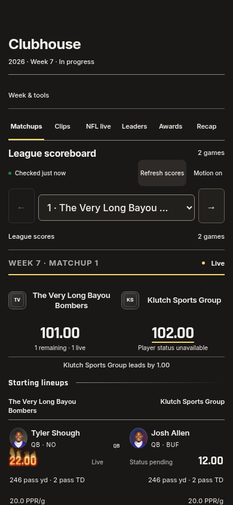
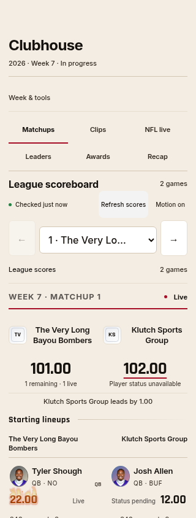
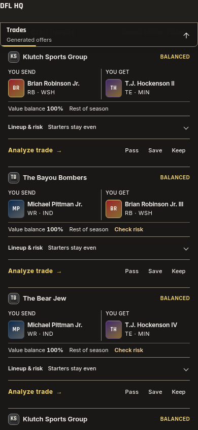
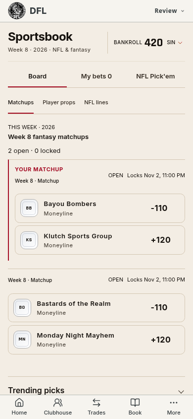
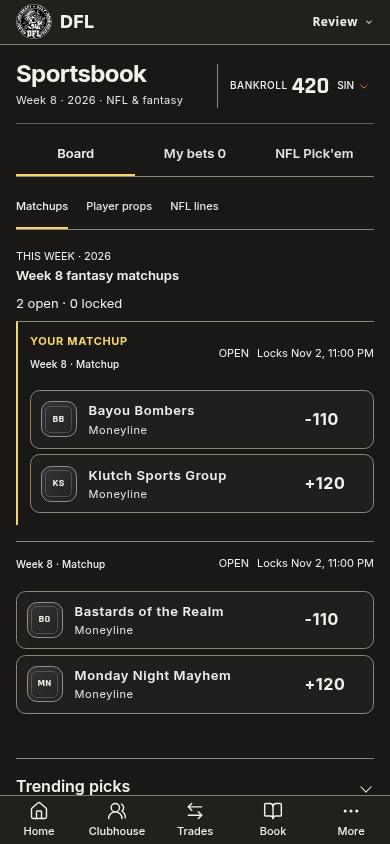

# Matchups, markets and offer tickets — 1.530.0

Clubhouse uses a compact selected-matchup header and puts the side-by-side
starting lineups before team status, live-football context and supporting
stories. A native matchup selector and previous/next buttons keep every game
reachable. League scores expand in place using the existing reversible
disclosure motion; opening them reveals the selected game in the rail. Names,
chosen team photos, scores, player effects, records, clips, rivalry and chat
remain available. The scroll reference supplies the selected scores after the
header leaves; a second sticky score strip no longer competes with it.

Sportsbook combines its product/account destinations into Board, My bets and
NFL Pick'em. Market filters stay inside Board. All three destinations share one
keyboard-controlled tab group and reversible swipe transitions. Saved choices,
player/ticket links, slip review and betting controllers retain their behavior.
Fantasy market rows show each team once; the full matchup heading remains
available to assistive technology. Bankroll actions retain their disclosure.

Trade tickets show the complete Send/Get package, verdict and compact value
balance/time horizon. Injury/valuation risk and required-drop cues stay visible;
Lineup & risk reveals the full metrics, roster constraints and lazy lineup
comparison. Short fixture offers measure about 239px on a narrow phone and
several remain visible together when scrolling. Existing exact offers,
multi-team destinations, portraits, actions and return positions are retained.

Scroll references now suppress their fixed bar and cancel pending section
entrances while a detail dialog owns the viewport. Body-mounted dialog portals
are covered, including removal before their queued toggle event. Closing the
sheet restores the current reference with the existing finite entrance. All
observers, event handlers and transient effects are released on route teardown.
No new polling, animation loop, provider or database mutation was added.

Verification and evidence are recorded with the release in `theme-audit.md`.
Live account writes and physical iPhone Safari remain unmeasured; Book's full
renderer and betting interactions use isolated fixtures. Actual member screen
captures remain local.

Validation:

- `pnpm check`: 2,420 tests in 293 files, release markers, theme scan, types,
  identifiers and production build pass. The last lineup-order change also
  passes all six focused lineup tests; the final build and theme scan pass.
- Clubhouse: first-player visibility, selected matchup, previous/next, native
  league-score scrolling, live/final state, game/clip/player viewing and effects.
  Compact/Comfortable and 125/200% text layouts fit, including long team names.
- Trade: 112 offer-reading checks, full search/analyze/share workflow, exact
  retained DOM/portraits, reversible impact disclosure, return position,
  multi-team destinations, editing/Undo and larger text.
- Book: six full-renderer mobile cases in both themes, unified destination
  keyboard control, scoped market filters, bankroll actions and slip review.
- Motion: 90 press/transition checks, native interrupted tab swipes, dialog
  suppression/restoration, cached heading positions and clean teardown.
- Compiled Home/Clubhouse/Trade: 18 read-only cases at 320/390/430px in both
  themes with no horizontal overflow or browser exceptions.

Evidence: [entry](competition-reading-1530/entry-checks.json),
[layouts](competition-reading-1530/clubhouse-layout-checks.json),
[offers](competition-reading-1530/offer-checks.json),
[Book](competition-reading-1530/book-checks.json),
[motion](competition-reading-1530/motion-checks.json),
[scrolling](competition-reading-1530/scroll-checks.json),
[compiled routes](competition-reading-1530/compiled-checks.json).

