# Home and Clubhouse interface foundation — 1.524.0

This is the first adoption of the [shared visual standard](interface-standard.md):
clear text roles, compact interface typography, predictable controls and quiet
rows. It establishes reusable rules for later routes. Broadcast artwork, league
banter, exact scores, rosters, destinations and existing motion retain their roles.

1. **Home entry — clearer hierarchy, verified.** The page title uses the same
   24px interface role as Clubhouse. Team names, records, actions and section
   jumps use the local Inter face; score totals retain boxy, tabular sports type.
   The title, names and scores now have deliberately different emphasis.

   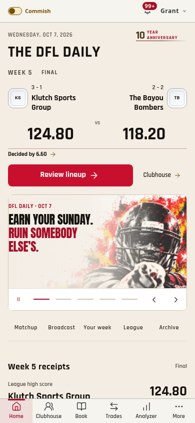
   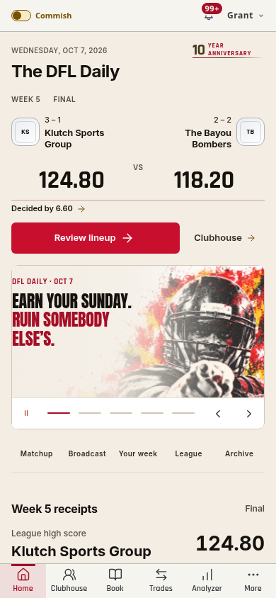

2. **Home weekly/league rows — consistent reading roles, verified.** A 16px
   section title leads into a 20px story headline, 13px identity/body copy and
   quieter metadata. Briefing rows use the same spacing grid. Weekly and position
   tabs adopt the shared control family and preserve their sliding indicators.
   Rankings, archive stories and tool links share the same title/name rules;
   transparent rows and soft dividers replace unnecessary framing on tool links.

   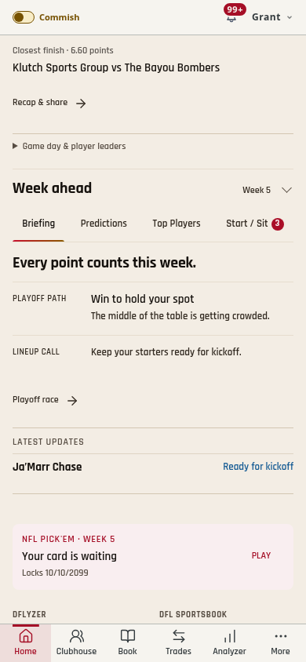
   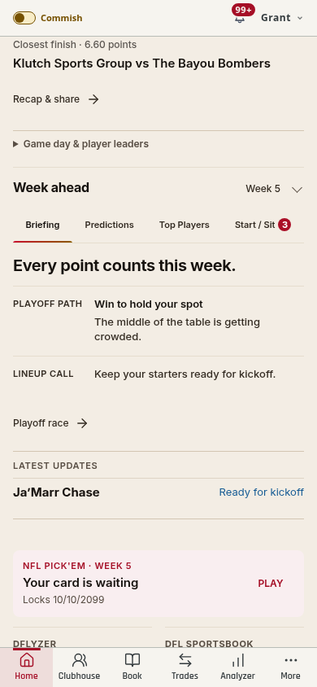
   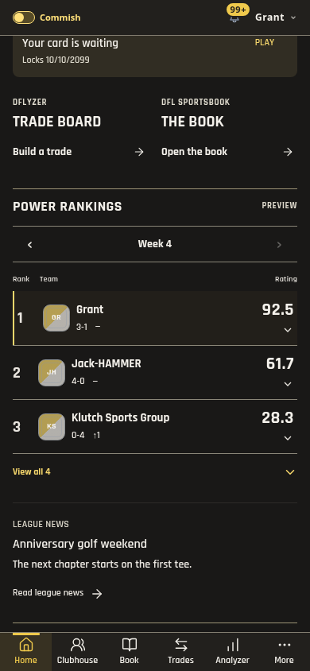
   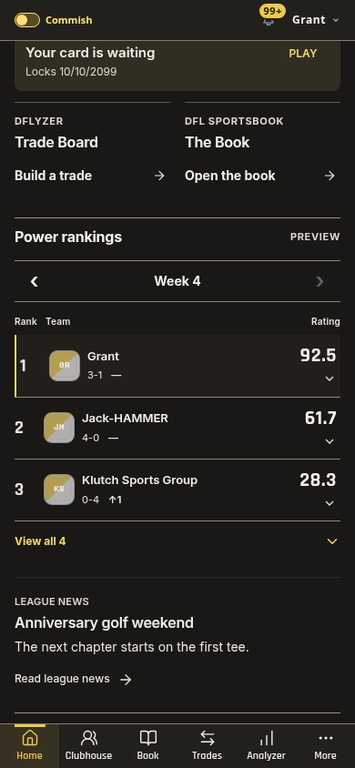

3. **Clubhouse entry and selection — refined and verified.** Removed the eyebrow
   repeating the page's purpose. Header, section titles, native pickers and tabs
   use shared roles. Utility controls and selected-matchup framing are quieter;
   all important controls retain at least 44px height. Native select text stays
   16px. The matchup picker reveals the selected game on entry or selection;
   ordinary score updates do not re-center a rail the reader has browsed away.

   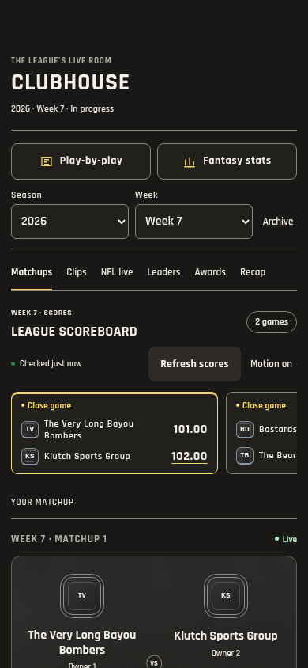
   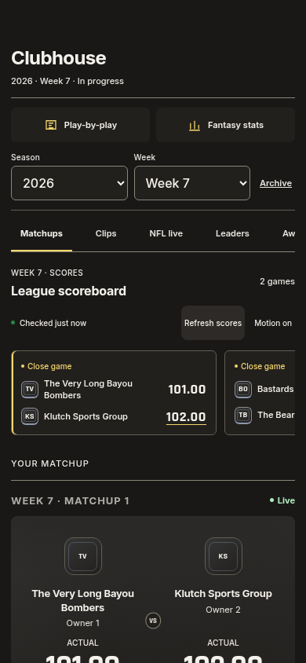

4. **Identities, lineups, clips and NFL stats — reviewed and verified.** Team and
   player names use the interface face with quieter owner/position labels.
   Scores retain sports numerals. Matchup art loses excess outer framing. Lineup
   stat lines use the metadata role and less unnecessary reserved QB space;
   average PPR remains visible. Side-by-side stats, full play descriptions,
   clip controls, player sheets, notifications and tab/gesture behavior continue
   through their existing production controllers.

   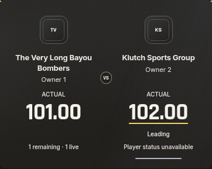
   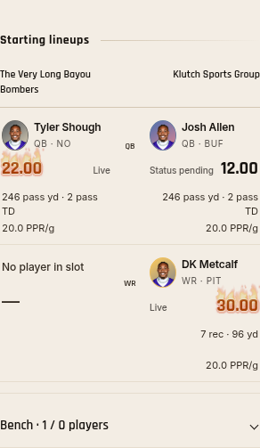
   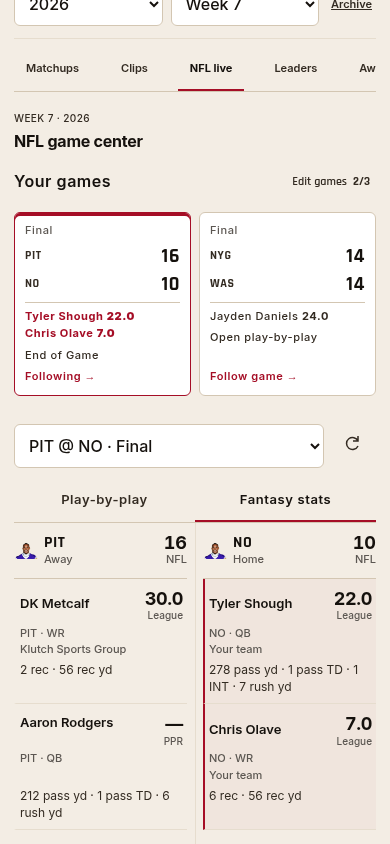
   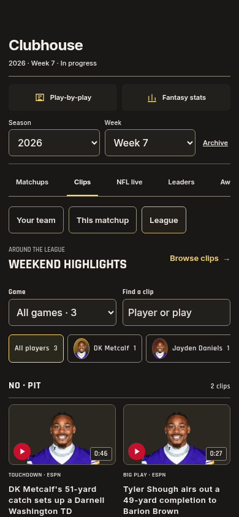

5. **Readability, motion and real app — checked within browser scope.** Both
   Medicine Wheel themes, long names, 320/390/768px Home layouts, enlarged text,
   Comfortable mode, contrast, keyboard navigation, native rails and score-dock
   return are checked. Comfortable mode explicitly raises shared text tokens;
   it is not overridden by compact rules. The broadcast keeps its independently
   verified 232px mobile composition and existing art direction. No new motion
   controller, polling or perpetual effect is added.

   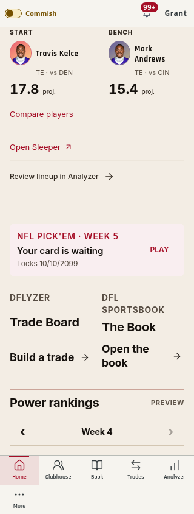
   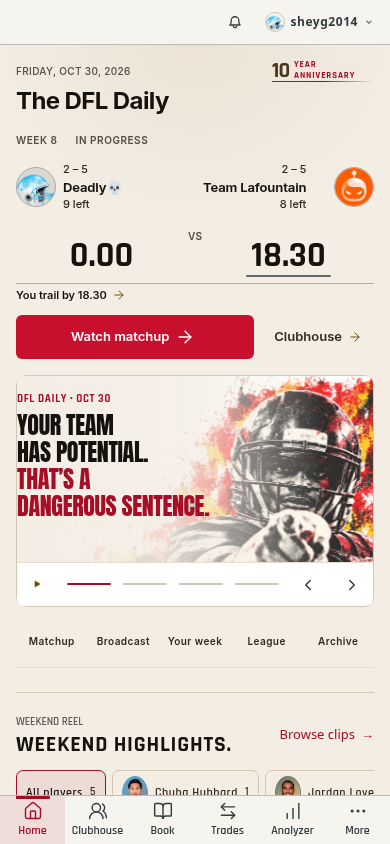
   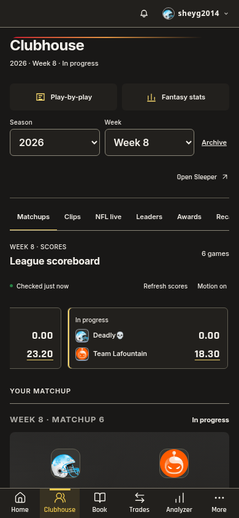

Validation includes `pnpm check` (2,419 tests in 293 files), 24 Home foundation
layouts plus six enlarged captures, 347 weekly checks, 63 scoreboard checks,
the complete Clubhouse controller suite with added interface/selection checks,
and 90 normal/56 enlarged broadcast layouts. The app remains 90 production
modules, three startup/four Home modules; 58 source CSS sheets are combined into
one request. The existing, precached Inter file is declared/preloaded locally.

Evidence: [coverage.json](interface-foundation-1524/coverage.json),
[home-checks.json](interface-foundation-1524/home-checks.json),
[clubhouse-checks.json](interface-foundation-1524/clubhouse-checks.json),
[real-checks.json](interface-foundation-1524/real-checks.json).

Limits: before/after component screenshots use isolated league/provider fixtures;
actual Home/Clubhouse are separately checked with real data and Supabase writes
blocked except allowlisted read RPCs. Physical iOS frame pacing, native picker
zoom and screen-reader speech are unmeasured. Other routes have not yet adopted
this standard. No paid data or external font service is introduced.
