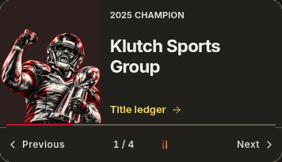
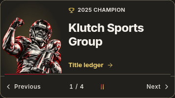
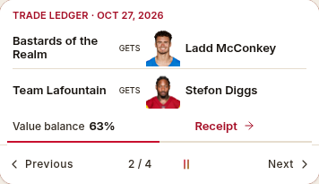
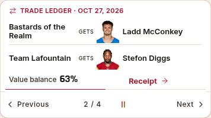
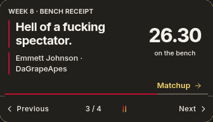
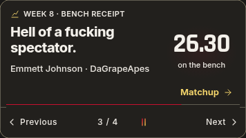
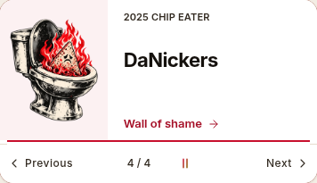
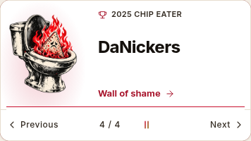

# League presentation and mobile continuity — 1.540.0

This pass uses the existing app and its 1.539.0 broadcast as the visual target.
It changes the production interface, not a separate prototype. Existing player,
champion and Chip Eater artwork, exact story destinations, first-slide identity,
league settings, trade values and notification behavior remain.

## Presentation

Broadcast categories retain one shared text-safe area and transport, with
separate award, score, trade and statistic treatments. The award illustration
sits over a soft radial glow that fades to transparent rather than a rectangular
color panel. Artwork remains contained and separate from the complete name.
Category marks are small decorative SVGs; no extra logos or image requests were
added. Stat figures use the sports typeface and a digit-aware size. Final
results show complete team names and scores side by side, stacking at enlarged
text sizes. Receipt rows keep actual recipients and the same direct receipt
link. The story picker scrolls within the measured card height instead of
forcing a taller stage or overflowing its top edge.

The Book's board rule and price typography distinguish its market rows from
Home. History uses its year figures and restrained ledger rules, with the same
shared tabs, controls, token palette and readable type scale. These are scoped
page refinements, not a new navigation system.

## Live viewing and performance

- A clip opened inside the NFL game viewer exposes **Back to play**, returning
  to the recorded reading position and restoring focus to the video link.
  The existing video element survives mode changes. Ordinary Home clip closing
  also preserves the opener's viewport position, as game-origin clips do.
- Resuming a fresh NFL game paints the cached view and resumes the existing
  poll cadence. A stale or changed week still refreshes. The front viewer remains active above an open matchup dialog; opening a player dialog above it pauses it. Explicit Refresh keeps
  its force-refresh behavior.
- Visibility, pageshow and focus events coalesce into one foreground request.
  A second wake does not invalidate an already-running refresh. Pause/stop
  cancels queued wake frames and timers; final games keep the existing stop rule.
- IntersectionObserver gates the broadcast's scroll visibility work. Once
  offscreen, scrolling does not measure the card. Returning to the viewport
  resumes normal visibility/first-read behavior, with the existing fallback
  retained for browsers without IntersectionObserver.

## League voice

Existing weekly receipts now vary their final roast by the scored matchup and
week. Names, points, margins and slot-eligible bench evidence remain the actual
story. A refresh or date change does not reroll the line. Historical eligibility,
unknown scores, draws and uncompleted games retain their existing protections.
No generic feed or additional informational subtext was added.

## Validation boundaries

Browser fixtures exercise the production renderers/controllers with provider
writes blocked. Cold-launch profiling uses fresh browser contexts, 4× CPU
slowdown, 150ms emulated latency and 187,500 bytes/s download on a local HTTP
fixture server. It is a regression observation, not a physical phone/battery
benchmark or a promise of real-user load times. Local serving, HTTP compression
and network protocol differ from Pages. Physical Safari and VoiceOver remain
unverified. No paid data service or database/schema change was introduced.

## Release checks

- `pnpm check`: 2,446 tests in 296 files, themes, release versions, types,
  identifiers and production builds pass.
- 90 normal and 56 enlarged broadcast layouts; eight editorial layouts plus
  story-picker, first-read, one-pass/manual replay, reduced-motion and 500-event
  offscreen-scroll checks pass.
- 129 NFL viewer checks, including one refresh per wake burst, preservation of
  an in-flight request, zero refreshes for a fresh resume and stacked dialogs.
- 309 Clubhouse checks, including exact play/clip/Back reading and focus;
  277 highlight checks retain video, filters, resizing and source cleanup.
- Secondary screens at 320/390/768px across four theme preferences and normal/
  enlarged text pass. Six compiled real-league Home, Clubhouse and History phone/theme screens
  have no page errors or horizontal overflow. Two Book captures verify only
  its error fallback because the read-only guard blocks wallet initialization;
  populated markets are checked separately with the real page controller and
  isolated account fixtures: six Light/Dark phone layouts, slip interaction
  and enlarged-text checks pass without writes or page errors. Private
  live-league captures remain local.
- Cold-launch observations, 1.539 → 1.540: plain app-ready 15,643 → 15,352ms;
  direct Home 15,066 → 14,921ms under the throttled fixture conditions above.
  Two samples per version establish a baseline range, not a speedup claim.
  The reproducible reductions are offscreen layout work and redundant refreshes.

| Treatment | Before | After |
| --- | --- | --- |
| Champion |  |  |
| Trade |  |  |
| Stat story |  |  |
| Chip Eater |  |  |
