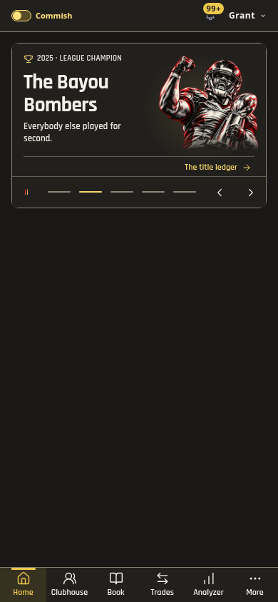
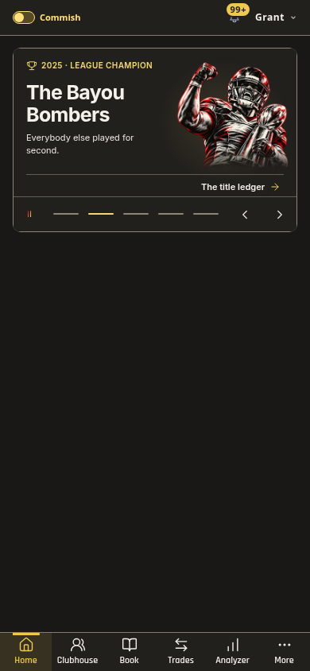
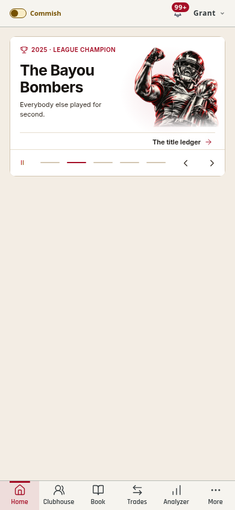
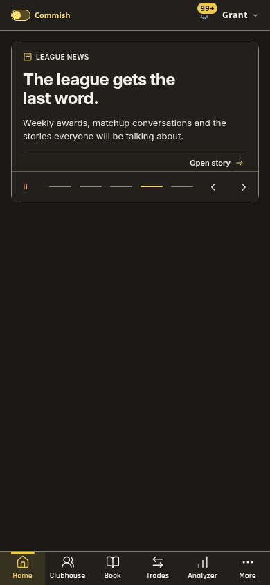
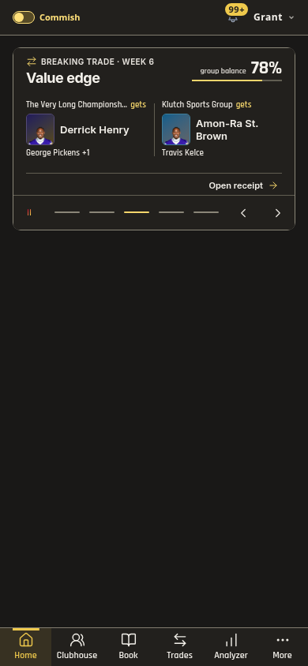
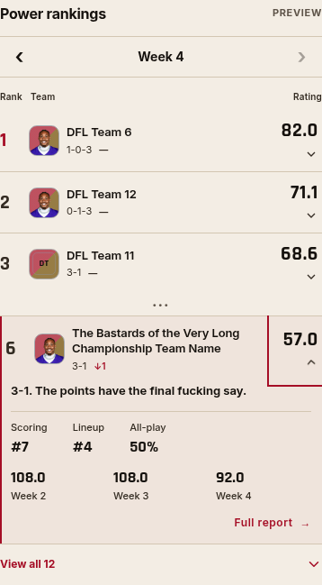
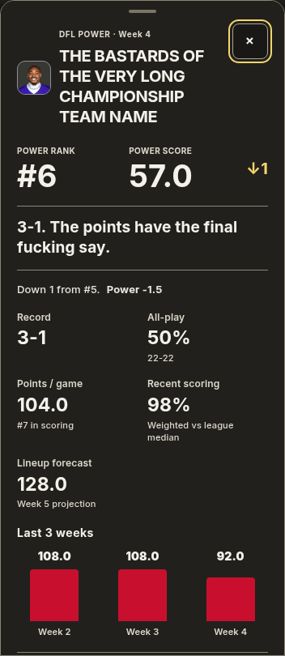
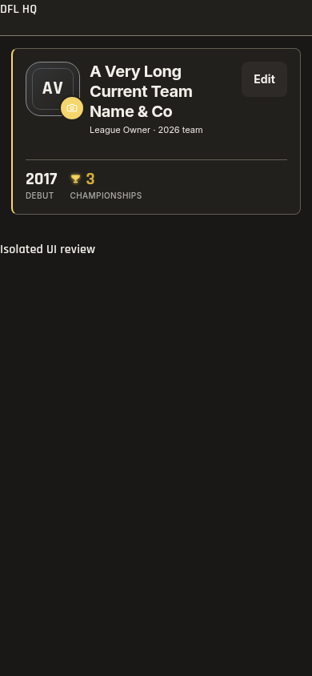
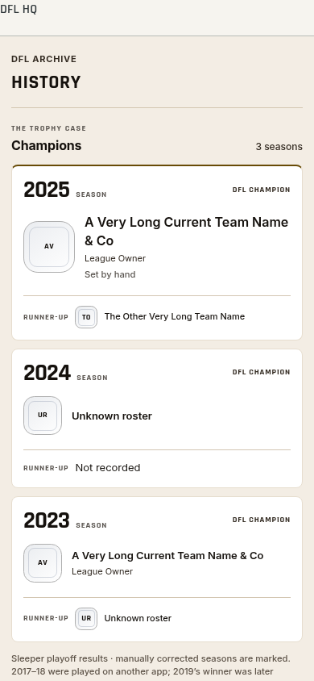

# League interface finish — 1.528.0

Broadcast stories now share the app's Inter identity, headline and action roles,
with Rajdhani for scores and exact balance figures. Awards use owned league art,
a restrained theme-colored light and clearer team names; the daily opener keeps
its own design. News leads with its headline, while receipts and results retain
their actual packages and figures. Enlarged-text footers stack instead of
clipping the score margin or action. The wide carousel, replay, gestures and
visibility controls retain their existing behavior.

Rankings now align compact team names, records, movement and ratings. Snapshots
retain their intrinsic expansion, continuous reversal and focus behavior. The
full report follows the visible viewport, with a sticky header and Close button
that remain available in a shortened viewport and while scrolling. The existing
photo connection and sheet dismissal are preserved.

Profiles and the archive use the same compact identity/body/metadata roles,
quiet surfaces and sports numerals as the daily pages. Native profile/archive
fields use 16px input text. An older high-specificity profile heading rule was
found during compiled-app review; the new font assertion prevents that rule
from silently restoring the previous heading face.

Clubhouse's existing matchup model supplies upcoming/live/final states. Those
states receive distinct, restrained borders and a final winner underline. Only
a real phase change receives a finite 200ms status transition; Motion off and
Reduced Motion apply. There are no new polling or continuous animation loops.

Validation:

- `pnpm check`: 2,419 tests across 293 files; release, theme, types, identifiers
  and production build pass. Shared CSS remains one request; no new font source.
- Broadcast: 90 normal layouts and 56 enlarged-text layouts, both themes,
  long names, contrast, 44px controls, exact figures, two/three-team receipts,
  soft-glow edge pixels, one-pass entrance, replay, swipe and Reduced Motion.
- Rankings: both themes at 320/390/768px; actual expansion transition sampled at
  a controlled animation time; reversal, report focus/Escape/touch dismissal,
  connected art reversal, teardown, enlarged text and motion preferences. A
  shortened/offset visible viewport keeps the sheet and Close button inside it,
  including after scrolling the report. Pointer report checks wait for the
  disclosure transition to settle before clicking its moving child.
- Profiles/archive: 320/390/768px, four themes including legacy Medicine Wheel
  and team colors, 100/200% text, profile input size/font, edit cancellation,
  broken-photo fallback, source links and More destinations.
- Clubhouse: 269 controller checks including live/final semantics, all games,
  existing matchup fit, Leaders effects and NFL viewing regressions.
- Member photos: saved Sleeper/DFL choice, uploads, removal, fallback ladder,
  own-member restrictions and error retries pass with isolated fixtures.
- Actual compiled app: 12 read-only mobile cases cover Home rankings, profiles
  and archive in Light/Dark at 320/390px, with no horizontal overflow or browser
  errors. Actual member screenshots remain local; committed images use fixtures.

Evidence: [broadcast](league-interface-1528/broadcast-checks.json),
[enlarged broadcast](league-interface-1528/broadcast-enlarged-checks.json),
[rankings](league-interface-1528/ranking-checks.json),
[secondary pages](league-interface-1528/secondary-checks.json),
[Clubhouse](league-interface-1528/clubhouse-checks.json),
[member photos](league-interface-1528/photo-checks.json),
[read-only app](league-interface-1528/real-checks.json).

Physical iPhone Safari is unmeasured. A local Linux WebKit launch was attempted
but remains blocked by missing host libraries, so no Safari/WebKit result is
claimed. No valuation, rankings calculation, scoring, provider, database, wager
or notification changes are included.
