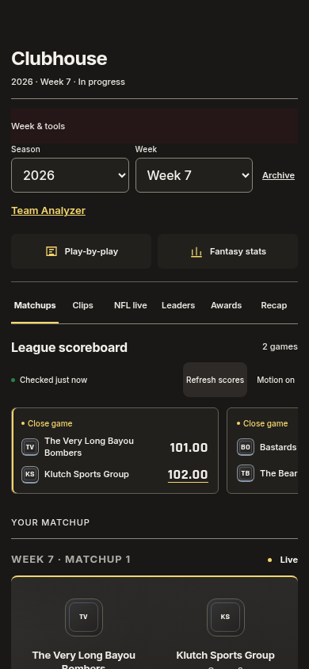
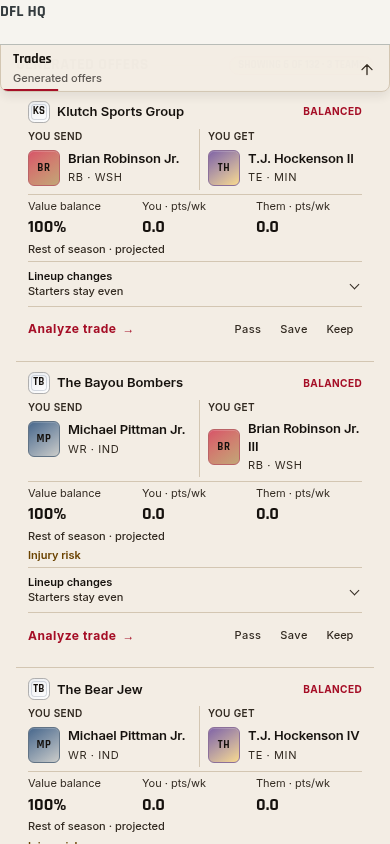
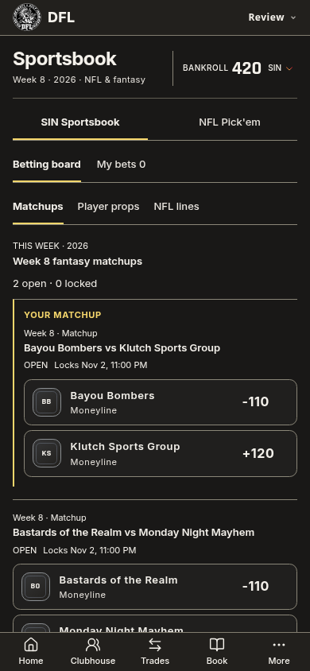
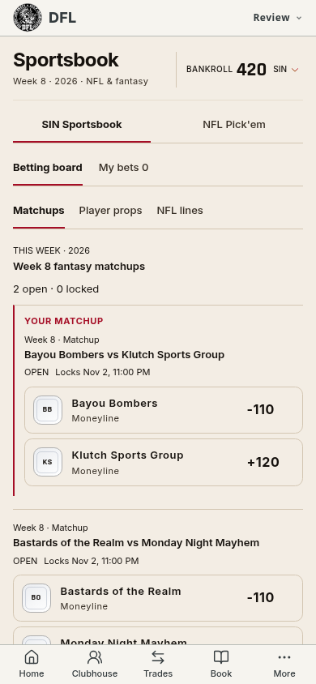

# League Wire — 1.529.0

The selected third design brings Home, Clubhouse, Trades and Sportsbook under
one compact mobile hierarchy. The round DFL mark and Inter wordmark share the
top bar. Home, Clubhouse, Trades, Book and More are the five main destinations;
Team Analyzer remains available in Clubhouse's Week & tools drawer and More.

Home opens with the matchup, three real newest highlight previews, the wide
broadcast, rankings, then weekly tools. The first clip has the larger frame;
Browse clips retains the complete reel and player/game filters. The preview
reserves its loading geometry so visibility-gated fetching starts reliably.
There is no embedded video on first paint. Phase changes preserve this reading
order, and Wall remains last. Existing scores, current names, daily banter,
artwork, awards and broadcast gestures retain their owners.

Clubhouse folds occasional week/archive/external tools into one visible drawer.
Trades opens with offers and a short search summary; Edit search reveals the
complete player and bidirectional position controls. These drawers reuse the
shared reversible expansion motion. No trade values or generation rules change.
Sportsbook keeps the balance visible while putting account actions behind it.
Its team names, market status and prices align as compact rows. Wallet Escape
restores focus, and the small menu entrance respects motion preferences.

The smaller matchup required adjusting the existing score flight. Its cached
start position now keeps moving copies invisible at rest; traveling names avoid
their own avatars and scores. The native and fallback paths share the geometry,
with no source measurements during scroll frames. Wide broadcast editions also
reserve exceptional wrapping once per edition so long result names and footer
actions cannot collide with carousel controls.

Validation:

- `pnpm check`: 2,420 tests in 293 files, release markers, themes, types,
  identifiers and production build pass. Final CSS adjustments were rebuilt
  and rechecked with `pnpm themes` and phone captures. Shared CSS remains one
  request, with no new font service or continuous animation loop.
- Home score motion: 18 native/fallback cases, both themes, reversing scroll,
  live name/score updates, no copies at scroll zero, no name/score collisions,
  touch input at 4× CPU throttling and motion preferences.
- Highlights: full existing playback/browser suite plus the three-tile preview,
  exact selected clip, newest-first ordering, complete Browse recovery,
  enlarged text and loading visibility. No backend writes.
- Broadcast: 90 normal and 56 enlarged-text layouts, stable edition height,
  readable long names, one-pass entrance, replay and Reduced Motion.
- Clubhouse/interface: all game views, week controls, Leaders effects, NFL
  viewing, 24 Home layouts and six enlarged-text layouts.
- Trade: compact offers, expansion, source-target navigation, editing, Undo,
  multi-team routes, full position controls and 200% text.
- Book: six full-renderer phone cases at 320/390/430px in Light/Dark,
  bankroll disclosure, keyboard dismissal, selecting and reviewing a pick,
  enlarged text and no remote writes. Account data is an isolated fixture.
- Actual compiled Home/Clubhouse/Trades: 18 read-only cases in both themes at
  320/390/430px, five destinations, working drawers, real three-clip preview,
  no horizontal overflow or browser errors. More retains the current route.
  Actual member screenshots remain local. Live Sportsbook wallet initialization
  is intentionally blocked during read-only review; its renderer/controllers
  are checked with isolated data. Physical iPhone Safari is unmeasured.

Evidence: [score motion](league-wire-1529/score-checks.json),
[highlight interactions](league-wire-1529/highlight-checks.json),
[Home order](league-wire-1529/rhythm-checks.json),
[Book](league-wire-1529/book-checks.json),
[compiled routes](league-wire-1529/compiled-checks.json).

The selected reference and normalized compiled comparison are documented in
[design-qa.md](../design-qa.md). Screens committed here use isolated fixtures.
