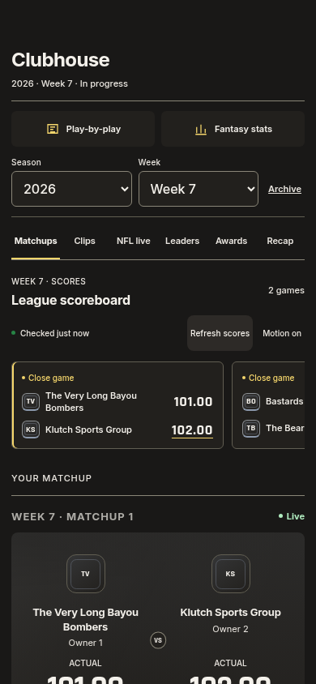
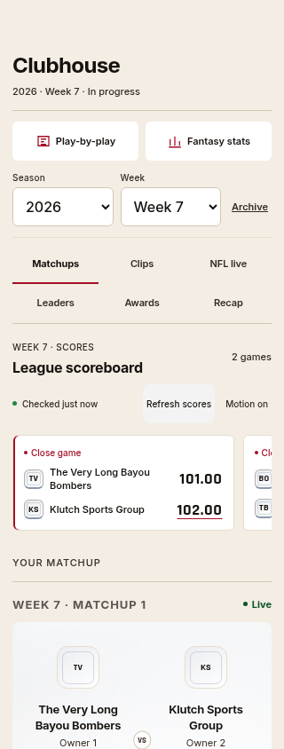
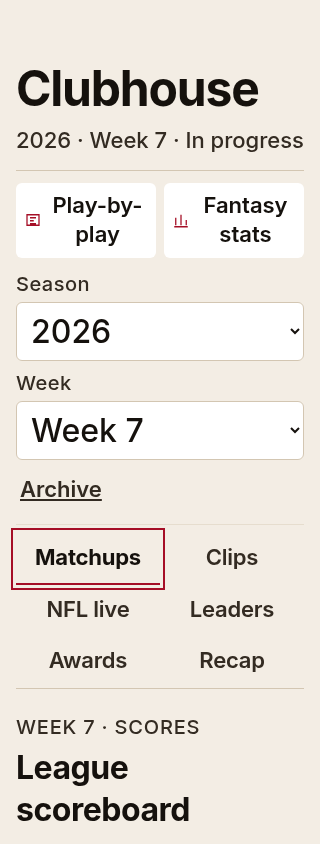
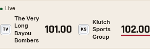
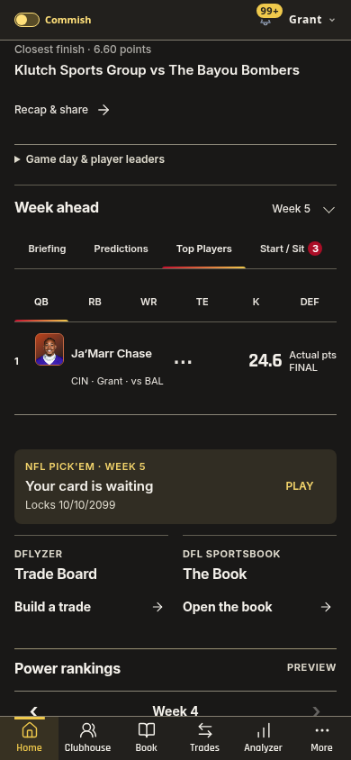
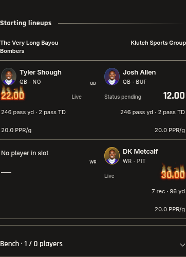

# Clubhouse fit, matchup strips and player rows — 1.525.0

1. **Clubhouse right edge — fixed.** The section tabs exceeded the phone's
   content width, concealing Awards/Recap. All six destinations now fit inside
   the navigation. Container queries use one, two or three rows as available
   width and text size change. The existing indicator follows both axes. Week
   pickers and the refresh/status row also reflow at larger text settings, so
   selected values and freshness text remain readable.

   
   
   
   

2. **Shared matchup reference — refined.** Home's compact returning scoreboard
   and Clubhouse's pinned lineup reference adopt the same mark/name/score roles.
   Clubhouse puts each exact score alongside its team identity, with responsive
   stacking when needed. State text stays quiet; the existing source decides
   lead emphasis, including ties/unknown values. Home's scroll flight and return
   target remain managed by the existing controller.

   
   

3. **Player rows — consistent.** Shared player rows explicitly separate identity
   and score roles. Home and league-leader portraits use a consistent compact
   32×36px frame. Full names wrap; scores use tabular sports numerals and retain
   actual/projected status. Clubhouse lineups use the same interface name role.
   Exact score/player keys, source photos, weekly lines, PPR averages, player-card
   actions and thermal effects are retained.

   
   

Validation: `pnpm check` passes 2,419 tests across 293 files, plus theme, release,
type, identifier and production-build checks. The layout matrix covers all six
Clubhouse tabs at 320/375/390/430/768px in Light/Dark, Compact/Comfortable settings,
and 100/125/200% text. It checks tab labels, touch targets, indicator placement,
picker values, content bounds and identity/score separation. The full Clubhouse
controller suite, Home weekly controls, native gestures, Home dock return and
read-only actual Home/Clubhouse checks are also exercised.

Evidence: [coverage.json](matchup-player-polish-1525/coverage.json),
[layout-checks.json](matchup-player-polish-1525/layout-checks.json) and
[real-checks.json](matchup-player-polish-1525/real-checks.json).

Limits: isolated component screenshots use provider/league fixtures. Actual Home
and Clubhouse are checked separately with Supabase writes blocked except
allowlisted reads. Physical Safari frame pacing and screen-reader speech remain
unmeasured. The horizontal matchup-card chooser remains a native scrolling rail;
it is distinct from the section navigation that now fully fits. No provider,
ranking, roster, scoring rule, polling interval or continuous animation changes.
