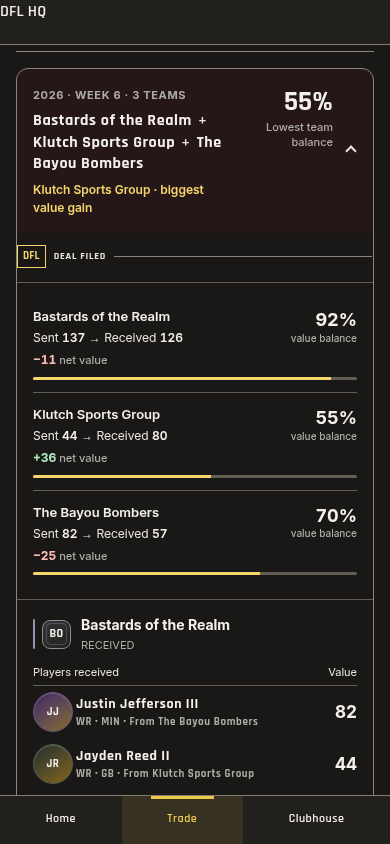
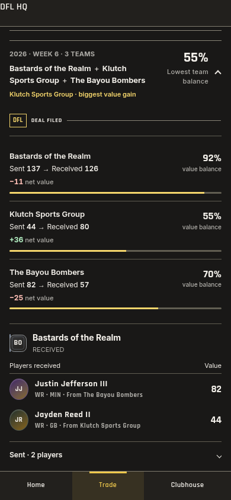
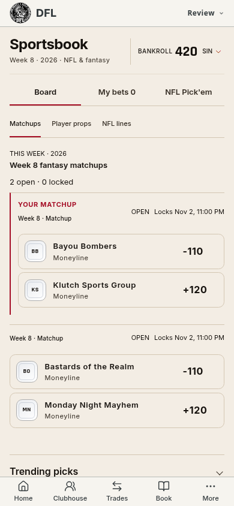
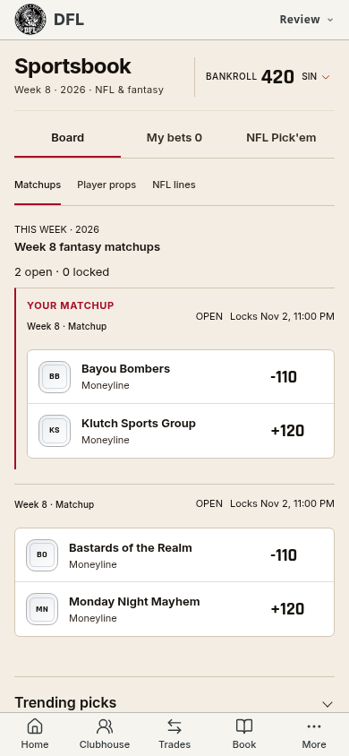
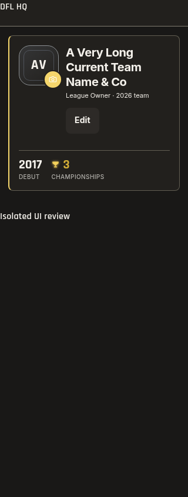
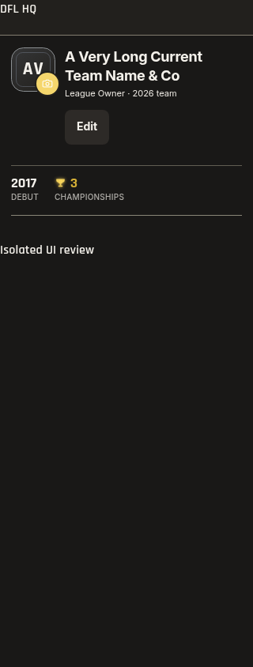
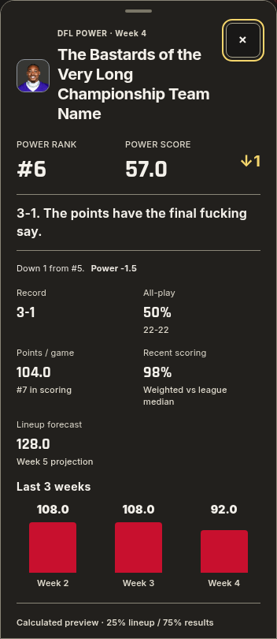
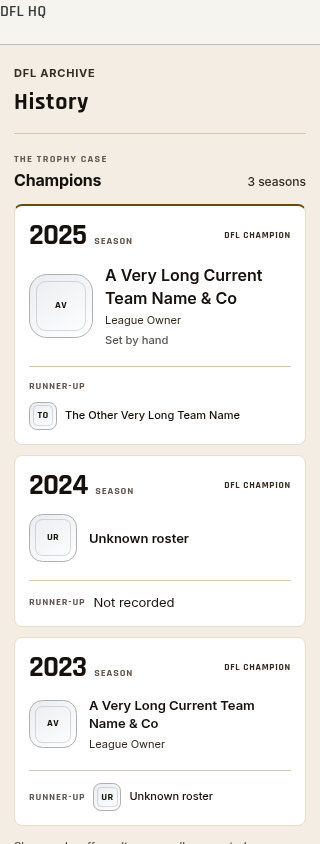
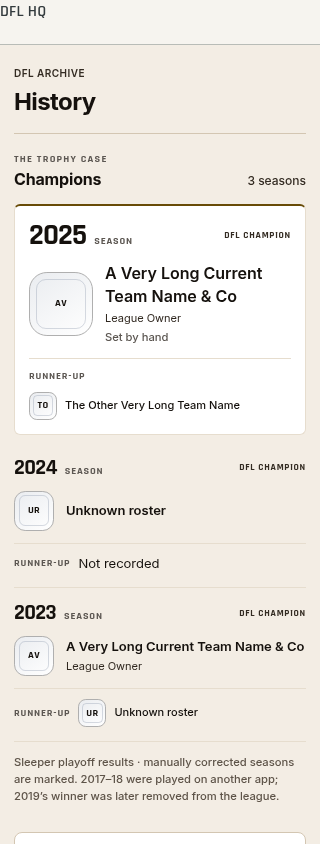

# Secondary-page mobile UI consistency — 1.538.0

The review compares the 1.537.0 baseline with this update, using fresh captures
of production renderers. Home and Clubhouse provide the reference scale. The
accepted fixture screenshots below contain isolated test data; compiled
actual-league captures are kept locally rather than publishing member details.

The change reuses Inter for reading and Rajdhani for sports figures, 44px
controls, existing Medicine Wheel tokens and the current navigation/expansion
controllers. It adds no data requests, artwork or animation loops. Player
values, grades, trade routing, standings, wagers and photo preferences retain
their existing logic. Arena and golf retain their dedicated layouts.

## 1. Trade analysis and receipts — improved; interaction checks pass

The baseline analysis ticket spent width on a second panel and inset padding.
Saved receipts used an enclosing tinted card and widely tracked team names.
The update uses full-width report rows, aligned decision metrics and lighter
separators. Receipts keep each team's sent, received, net and balance values;
player actions and received-from routing remain visible.

| Before | After |
| --- | --- |
|  |  |

84 editing checks cover full names, replacement, Undo, three-team destinations,
contrast, larger text and Reduced Motion. All 37 connected-receipt checks pass,
including exact receipt entry, Back position and focus restoration.

## 2. Sportsbook — improved; selections and slip checks pass

Separate bordered team options and tracked labels made each matchup look like
nested boxes. The two options now share one game surface, with normal tracking,
consistent name/metadata roles and distinct 20px odds. Existing selection,
locked/settled states, your-matchup highlight and semantic result colors remain.

| Before | After |
| --- | --- |
|  |  |

Six Light/Dark cases cover 320/390/430px, plus enlarged text and the existing
bet slip. The isolated provider records no unauthorized writes.

## 3. Profiles and rankings — improved; identity and expansion checks pass

The profile identity used a bordered inset card and a larger avatar. It now
shares the page divider rhythm, a 56px portrait and a readable team name.
The portrait regression checks actual geometry, including text enlargement,
so the avatar cannot extend into the team name. Career headings and figures
share the interface scale. Editing, Cancel and photo fallback remain available.

| Before | After |
| --- | --- |
|  |  |

Ranking previews align their three facts and recent weeks. The full report uses
sentence-case names, quieter metadata and the same reading face while keeping
the original banter, photos, values and intrinsic expansion motion.

The rankings suite produces 26 result records, covering snapshots, dialogs,
week selection, connected motion, enlarged text and teardown.

## 4. History and archive — improved; record identity and reflow checks pass

Every prior season previously had the same card emphasis. The reigning
champion retains its feature treatment; earlier seasons now form a compact
list with smaller year labels and portraits. Current team labels, runner-up
information and links are retained. The runtime photo heading also follows the
shared type scale and wraps alongside its action at larger text sizes.

| Before | After |
| --- | --- |
|  |  |

Three widths, four theme preferences and 100/200% text cover archives, profiles
and More. The suite checks champion flags, unknown roster fallbacks, every More
route, photo failures and edit cancellation.

## 5. Remaining league pages and shared controls — improved; compiled checks pass

Fees and Calendar exposed older oversized headings. The shared header scale
now reaches those headings and the remaining page families. Fee totals use
lighter dividers and less panel decoration. Calendar titles and metadata use
clearer roles. Tabs retain 44px height; common secondary actions use the same
reading face. Polls, notifications, Wall, rules, lore and playoff pages receive
the shared reading and heading rules without new content or navigation.

28 compiled actual-league screen/theme cases pass at 390px. Another 16 cases
cover secondary pages at 320px and 200% text. Four additional 320px/200% profile and History cases also pass. All have no page errors or
horizontal document overflow. Their member/account screenshots are kept in
`/workspace/dfl-review-1538/compiled` and `compiled-edge`; the private full
walkthrough is `/workspace/dfl-review-1538/audit.md`.

## Validation and limits

`pnpm check` passes all 2,436 tests across 295 files, release versions, themes,
types, names and the production build. The shared Home interface also passes
24 normal layouts and six enlarged layouts. The authored changes are CSS plus
one portrait-containment browser assertion and release assets.

Screenshots and browser geometry can establish fit, spacing and the visible
states checked here. They do not establish full WCAG compliance. Physical iOS
Safari, VoiceOver, device frame pacing and all possible live-data states are
unmeasured. Account mutations were blocked during compiled captures. Product
Design's optional auxiliary preflight/browser resources were not exposed;
captures use the existing local Chromium setup. No canvas walkthrough was
requested. The before and after screenshot files were inspected before being
accepted into this report.
