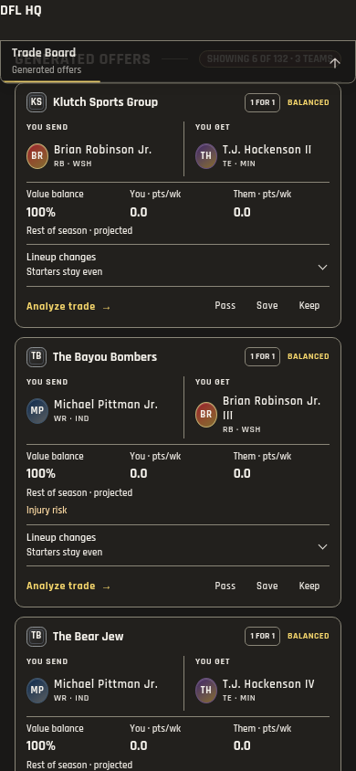
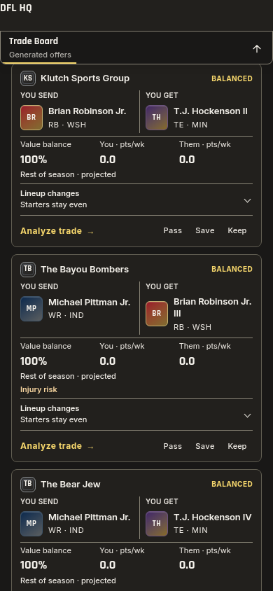
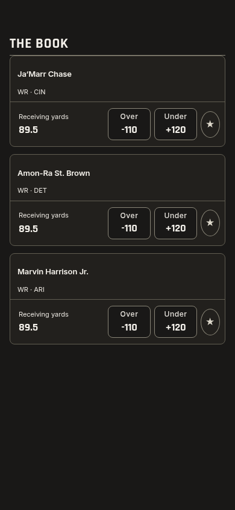
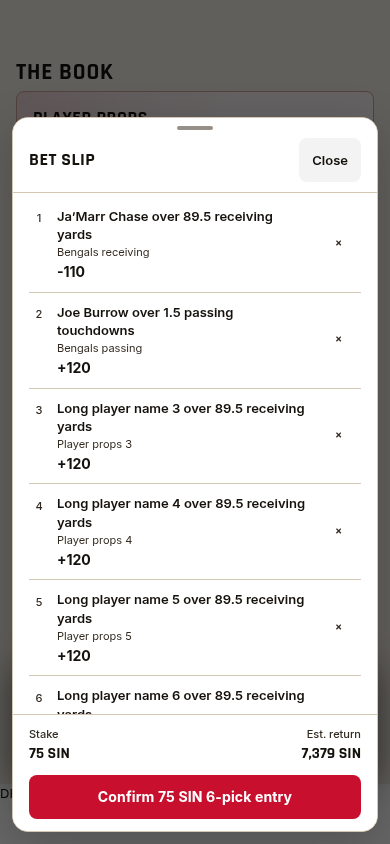
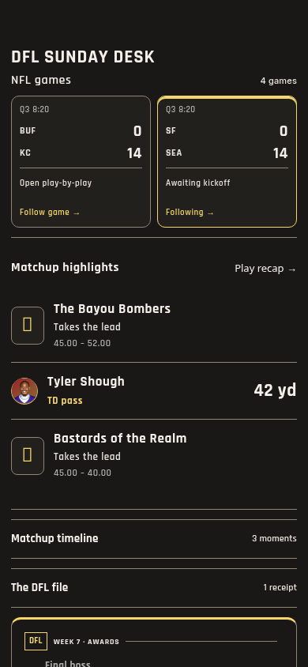

# All NFL games, Trade and Sportsbook polish — 1.527.0

Clubhouse's NFL rail now includes every game in the selected week. The three-game
pin limit, editor and saved-pin filtering are removed. Its game count makes the
full slate clear; selecting a game reveals its tile inside the rail. Subsequent
polls retain the reader's browsing position. Scores come from the existing
scoreboard. The selected game's summary is shared from the NFL center, replacing
the desk's separate summary requests rather than multiplying requests by the
number of visible games.

Trade adopts Inter for identities and metadata with tabular Rajdhani figures.
The send/get comparison remains compact, with full names and practical tap
targets. Removing the redundant package-size badge gives the counterparty name
more space; the Analyze action retains its accessible package description.
When offer batches update, matching offers reuse their actual cards and portraits.
Only new visible cards enter, over 180ms. The entire result list no longer fades.
Existing expansion, scroll anchors and focus return remain intact.

Sportsbook uses the same player-name and metadata roles, clearer prop figures and
smaller slip descriptions. Exact changed quotes paint immediately, followed by a
short ink transition; odds are never interpolated through intermediate values.
Quote updates leave the row and selection in place. Controls give restrained
press feedback. Slip fields reflow with enlarged text. Reduced Motion and the
existing motion preference apply to the new motion.

Validation:

- `pnpm check`: 2,419 tests across 293 files; release, theme, types, identifiers
  and production build pass. Final theme/build checks also pass.
- Trade: 106 reading checks, plus connected offer/detail motion and editing
  checks, including three-way routing, replacement, Undo and Reduced Motion.
- Sportsbook: 24 slip/prop layouts at 320/390/430px in both themes, including
  exact quote changes, stable row height, no wager RPCs, 200% text and focus return.
  The provisional/official result and share-image suite also passes.
- Network experience: 108 checks, including every game, legacy pin removal,
  selected-tile visibility, stable buttons and no summary-request fan-out.
- Clubhouse: all 264 controller checks pass, including prior clipping and
  Leaders effects regressions.
- Read-only actual app: 10 cases confirm all 14 games, the selected tile and
  actual Trade cards at mobile widths in Light/Dark, with no browser errors.

Evidence: [Trade](trade-book-all-games-1527/trade-checks.json),
[Book](trade-book-all-games-1527/book-checks.json),
[network](trade-book-all-games-1527/network-checks.json),
[actual app](trade-book-all-games-1527/real-checks.json).
The committed images use isolated fixtures. Actual Sportsbook account loading
requires its wallet-touch RPC, which is deliberately blocked by the read-only
live review; its production rendering and interaction controllers are exercised
with isolated account fixtures. Physical Safari remains unmeasured. No valuation,
grading, wager, database or notification changes.
