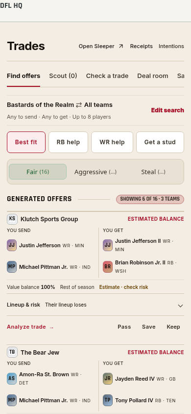
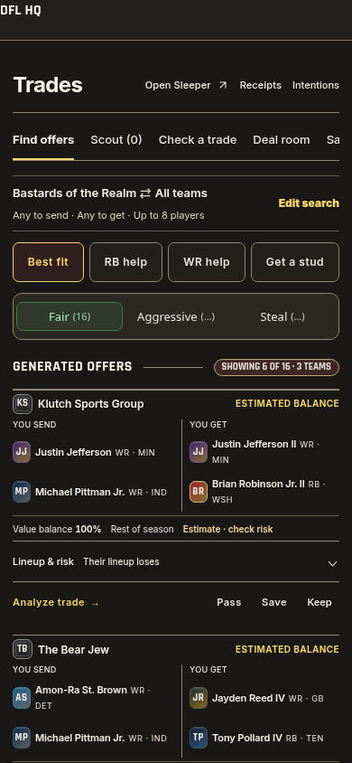
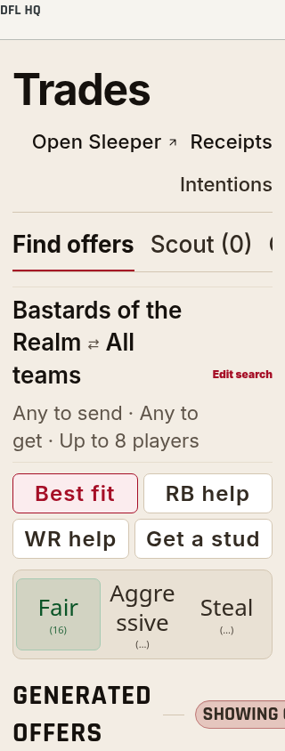
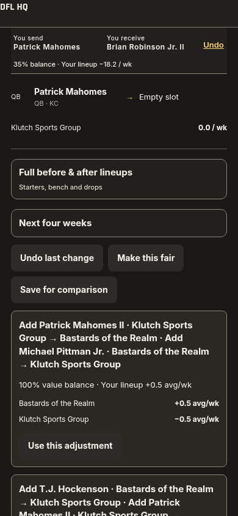

# Trade discovery and small fair repairs — 1.539.0

## Behavior

- Targeted package search and package-edit ordering now use the same whole-package prices as the final grader. In a tagged 1QB pool, the strongest QB retains full value, the second contributes 20%, and additional QBs contribute no package premium. Untagged formats and individual player values retain their existing rules. Cardinality bounds account for the QB discount rather than summing invalid marginal prices; the search remains bounded.
- The default **Best fit / All teams** search removes idle Fair swaps and Fair recommendations with material roster harm. A useful change requires a starter gain over 0.2 projected PPR points per week or a depth-inclusive gain over 0.3, with no participant losing more than 0.75 in either measure. The selected next-four-week window is used when available. Price grading remains separate: manually checking a balanced but harmful trade still shows balanced price and the lineup loss. Explicit player targets, chosen partners, other goals and multi-team searches keep their wider search space and existing quality ranking.
- **Best fit**, **RB help**, **WR help** and **Get a stud** are visible without opening Edit search. Get a stud uses the existing Depth for a stud goal. Advanced goals, targets, positions, package sizes and member routing remain available. Position exclusions disable incompatible goals, apply to both directions and reset an invalid selected goal. Search caches and intent counts include the selected goal.
- An unbalanced manual deal exposes **Make this fair**. The existing bounded counteroffer engine examines additions, removals and replacements, preserving explicit locks and each participant’s most valuable outgoing player. New additions and replacements respect the selected positions in both directions; players explicitly chosen in the manual deal remain selected. Repairs must regrade at least 90% balance, retain complete projections, avoid immediate cuts of incoming players, and avoid material roster harm. A usable one-edit repair is preferred over two-edit repairs. If none is found, the UI says so. Balanced deals retain **Find a counteroffer**.
- Repair previews never send an offer or change selected players. Applying one updates the analysis in place, preserves roster filters and destinations, focuses Undo, and saves the local draft through the existing onDeal callback. Undo restores the prior selection and routes.
- Compact offer rows lose spare outer padding; player links, disclosure and actions retain 44px targets. Whole packages, required drops, confidence warnings, expert evidence, live refresh, Steal protections, share cards and the eight-player limit remain.

## Regression coverage

Added exhaustive small-roster price-neighborhood comparisons across package sizes, locked QBs and saturated backup-QB value; a targeted package/final-grader agreement case; useful/default Fair recommendation cases; genuinely fair and unavailable repair cases; and one-edit repair preference. Existing positional PPR, FantasyPros agreement/staleness, elite/streamer QB, consolidation, required-drop, injury/season-ending IR, split routing, anchor and large-package suites remain part of the complete check.

The browser review uses real page handlers, workers and model code with isolated sample rosters. External writes are blocked. It verifies goal focus/state, both-direction exclusions, fair preview/apply/Undo, honest unavailable repairs, contrast, enlarged text and reduced motion. Existing editing, offer-reading and complete-workflow checks remain in place; old fixed first-offer assumptions now compare actual restored packages because recommendation order legitimately changed.

## Boundaries

This release does not add a paid feed or change the FantasyPros refresh pipeline. Forecast and expert uncertainty remain visible. Bounded search can report no small repair without claiming no possible trade exists. Physical iOS/Safari, VoiceOver and phone battery measurements were not performed in this environment.

## Verified release checks

- `pnpm check`: 2,445 tests in 296 files, theme audit, identifiers, type check, release versions and production builds pass. Compiled worker and 90-module app bundle validate.
- 128 goal/repair checks across 320/390px, Light/Dark, normal/enlarged text, normal/reduced motion; includes rapid goal switching, focus, contrast, preview/apply/Undo and honest unavailable repairs.
- 88 position-control checks; 84 editing checks; 112 compact-offer/expansion/Back/motion checks.
- Complete trade workflow at 320/390/768px: split destinations, stale ownership, saved comparisons, fair repairs, multi-team share eligibility, injury recheck and receipt routing pass, without page errors or horizontal overflow.
- Compiled production Trade and Analyzer screens with live league read-only data: four phone/theme cases pass without page errors or horizontal overflow. Private screenshots remain outside the repository. Provider writes were blocked.

